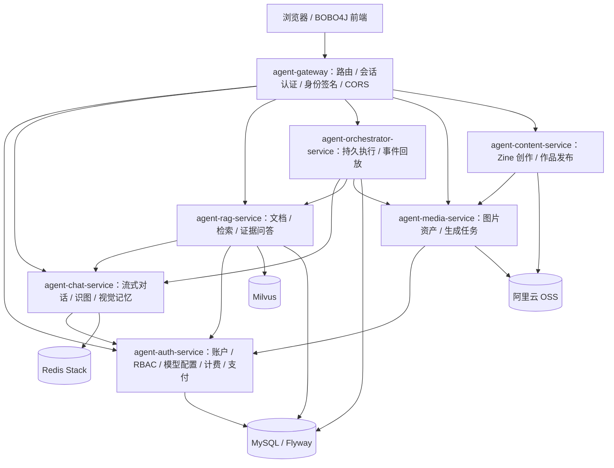

# BoboWorld4J（BOBO4J）

**基于 Java 21 与 Spring AI 的 AI 应用平台后端：流式对话、文档 RAG、可恢复 Agent、图片创作与账户计费。**

BOBO4J 把模型调用、知识检索、工具执行和消费结算拆分为边界明确的服务：用户可以上传文档获取摘要并连续追问；可以让 Agent 完成多步任务，在中途停止、断线后重连，并查看执行进度与引用来源。

本仓库是**后端与基础设施**聚合工程，配套前端为独立仓库 [Bobo_web](https://github.com/bbb-520/Bobo_web)（React 18 + TypeScript + Vite）。前后端整体统称 **BOBO4J**，源码目录与 Maven 模块名保留 `agent-*` 命名。

## 五种聊天模式与图片生成（2026-10-13）

本次补全纯文字生图和独立图片任务入口。默认使用“智能聊天”，明确指令如“帮我生成一张图片：海边日落”会自动切换图片生成；回复上方标注本次实际模式。询问原理、教程、翻译、提示词写作和否定语句保留为问答，模糊创作需求可手动选择图片生成。

| 模式 | 输入与用途 |
| --- | --- |
| 智能聊天 | 文字、图片、文件或混合附件；自动选择问答类型，明确生图指令自动生成 |
| 文本聊天 | 纯文字，不沿用旧图片或文件；明确生图指令仍可转为纯文字生图 |
| 图片多模态 | 识别、理解、比较图片，最多 3 张，支持沿用图片追问 |
| 文件多模态 | 文件概要、检索、问答，可搭配图片，支持沿用文件会话 |
| 图片生成 | 纯文字生成一张图片，或上传一张参考图编辑；不接收文档或多张参考图 |

普通附件最多 8 个，图片最多 3 张、每张 20 MiB，文件每份 100 MiB；扫描 PDF 暂不支持 OCR。参考图片建议使用 JPEG/PNG/WebP/GIF；资产上传接口不支持 BMP/TIFF，需先转换格式。

图片生成先持久化客户端请求 UUID，再创建服务端任务；刷新、响应丢失和重试均核对同一请求，不另建收费任务。已受理后显示独立任务卡，输入框解除本页等待。上传及受理等待有 2 分钟上限，上传失败需重新选择文件；过期或不可用参考图返回明确的 400。任务查询每次最多等待 15 秒，列表暂时不可用时仍继续查询本地已受理任务。失败终态及实际模式在刷新后保留。

停止按钮停止本页等待；已受理的供应商任务仍继续，完成后可刷新查看，也会按实际结果结算。停止意图会持久化，刷新只查询，不补发未受理任务。免费 100 万 Token 仍通用于所有模型，图片优先实际 Token，无 Token 回执按现有价格折算；查询和幂等重放不产生新消费。

### 图片任务 API 与配置

- `POST /api/image-jobs`：登录、`media:generate` 权限及 CSRF 校验；请求包含 `requestId`、`conversationId`（UUID）、`prompt`、可选 `attachments`（一个自己的 READY 图片资产）。返回 202 和任务快照。
- `GET /api/image-jobs/by-request/{requestId}`：只查询当前用户自己的请求，缺失返回 404；相同请求 ID 但提示词/来源不同返回 409。
- `GET /api/image-jobs/{jobId}` 与 `GET /api/image-jobs?conversationId=...`：查询当前用户任务和恢复结果。
- 新增 Media 的 `V5__media_text_to_image.sql`：来源资产改为可空，增加请求指纹及 `(tenant_id,user_id,client_request_id)` 唯一索引，旧参考图入口保留。唯一索引与现有用户活跃任务约束共同限制重复任务。

配置在 `agent-media-service/src/main/resources/application.yml`，生产以 `/opt/agentdemo/compose.json` 的 Media 环境变量覆盖。通过编辑部署文件、执行 `docker compose -f /opt/agentdemo/compose.json up -d --no-deps agent-media-service` 应用；不要把密钥写入 GitHub 或输出完整环境变量。

| 属性 | 用途 |
| --- | --- |
| `IMAGE_JOBS_ENABLED` / `ZINE_ENABLED` | 开启任务处理 / 生图供应商，当前均为 true |
| `PLATFORM_IMAGE_MODEL` | 生图型号，当前 `qwen-image-3.0-pro` |
| `ZINE_IMAGE_BASE_URL` / `ZINE_IMAGE_ENDPOINT` | DashScope 接口地址 / 多模态生成路径 |
| `ZINE_IMAGE_SIZE` / `ZINE_IMAGE_TIMEOUT` | 输出尺寸 / 单次供应商调用超时，默认 `1024*1707` / `180s` |
| `IMAGE_JOBS_LEASE_DURATION` / `IMAGE_JOBS_MAX_ATTEMPTS` | Worker 租约 / 最大尝试次数，默认 5m / 2；未知结果不凭超时重复派发 |
| `OSS_ENABLED` / `ALIYUN_OSS_REGION` / `ALIYUN_OSS_BUCKET` / `ALIYUN_OSS_ENDPOINT` | 输出及参考图片存储配置 |
| `ALIYUN_OSS_ACCESS_KEY_ID` / `ALIYUN_OSS_ACCESS_KEY_SECRET` | OSS 凭据，仅部署环境保存 |

Qwen 文生图请求只包含 text，图生图增加 image；格式以[阿里云图像生成与编辑接口文档](https://help.aliyun.com/zh/model-studio/qwen-image-generation-and-editing-api-reference)为准。模型 Key 继续通过已有用户/平台模型配置解析。

本次验证：完整后端 Reactor 共 462 项测试，457 项通过、5 项环境集成测试跳过，0 失败/错误；独立发布副本继续排除依赖原始工作区部署文件路径的 `DeploymentAssetsContractTest#deploymentAssetsRemainPresentAtRepositoryRoot`。前端 15 组测试脚本及生产构建通过，其中模式路由 35 项、图片请求恢复 13 项；复核问题均先复现失败再修复。

2026-10-13 已部署到 `https://www.boboo.xin/`，发布目录 `/opt/agentdemo/releases/20261013-image-modes-v1` 保留数据库、Compose、旧应用备份和验收记录。仅更新 Media 与前端镜像，V5 迁移成功，媒体 JAR、全部 21 个静态文件及公开入口资源与测试产物哈希一致；15 个容器运行正常，13 项已配置健康检查均通过，匿名请求查询返回 401。

真实供应商验收：隔离账户分别完成纯文字生图、单参考图编辑，OSS 成品均返回 200；各次幂等重放和按请求查询返回同一个任务，参数冲突返回 409；每次只记一条消费、扣 100,000 免费 Token，现金扣费 0。测试账户剩余 800,000 Token、无在途占用，已禁用并撤销全部会话，回执和附件保留审计。

线上回归的实际范围：文字聊天、纯图片理解与追问、文档上传/索引/摘要、重排序检索及公开纯文档概述均有成功回执。完整文档问答与图片文档混合问答**本轮未全部通过验收**：曾发生向量/重排序连接中断，以及答案评估不可用。前两次未知调用已自动进入 ABANDONED 并释放占用；评估失败进入 FAILED，未发布未经核验的答案。没有将未知用量改为零，也未用重复派发绕过对账。5 个隔离测试账户均已禁用、会话数为 0、现金余额/预留为 0、无账户占用，失败记录保留在发布目录。此限制属于现有文档模型链路的可用性，本次图片生成与模式划分未声称修复其全部外部调用问题。

## 附件异常与账户占用恢复（2026-10-13）

修复文档/图片处理失败或刷新后，账户一直提示“处理中或待对账”且无法发送消息的问题。根因是供应商拒绝、连接建立失败、真正未知结果共用一个无限期等待状态，以及前端附件与创建请求的恢复循环没有截止时间。

- 明确的供应商拒绝（400/401/403/404/405/413/422/429）和建立连接失败单独登记；没有成功派发的配置错误清理预留。真实用量保存失败、派发后超时及断流仍保留未知证据，不能当作零用量。
- Auth 每 15 秒检查调用组。超过 180 秒无状态更新时，先结算已有完整回执；无法结算则进入不可自动重派的 `ABANDONED`，释放该组的钱包占用和执行槽位。迟到回执只保存证据，不影响新请求、不事后向用户扣估算费用。
- 新增 `V10__model_call_recovery.sql`，记录明确拒绝和超时解除的依据及平台估算风险。未确认成本由平台故障预算保留估算风险，**不等于供应商实际账单**；用户余额和免费 Token 只按已核实结果结算。备用调用派发前取消会幂等释放平台预留。
- 独立图片创作采用较长的 600 秒失联窗口（涵盖生成和 OSS 复制），由原有每分钟清理任务解除长期占用，写入 `usage_reconciliation` 的 `ABANDONED` 记录，保留未知用量；不扣用户现金或 Token，未交付的旧图片试用返还，迟到结算不能扣新请求。可用 `BILLING_IMAGE_RECOVERY_STALE_SECONDS` 延长窗口，代码最低为 600 秒。
- 文档明确失败进入失败状态；未知结果继续可审计。用户显式重试会提升处理版本，新问答等待新索引发布，避免复用旧调用 ID；重建期间已有问答会话仍可使用自己固定的旧索引，发布后执行版本校验。执行器保留 HTTP/SSE 的安全错误码，明确失败有终态；旧中断调用要求重新发送，不自动重复调用。
- 前端附件准备最多等待 10 分钟，文档上传 XHR 最多 2 分钟，文档问答等待账户空闲最多 210 秒；单次状态请求最多 60 秒，连续 5 分钟无法同步执行状态时释放本页等待，正常进度会延长观察。创建尚未返回 ID 时也能停止本页等待，原请求 ID 和停止意图保留用于恢复。
- 文档答案评估格式无效时，任务明确失败且不发布未核验答案；已经开始的 SSE 以错误帧结束，避免改写 HTTP 响应导致错误的“等待对账”。评估模型调用、回执和账务查询异常原样保留，真正未知消费仍需对账，不当作格式失败。

配置位于 Auth 的 `application.yml` 或实际部署环境：`BILLING_RECOVERY_STALE_SECONDS` 默认 180（代码最低允许 180），`BILLING_RECOVERY_DELAY_MS` 默认 15000。调度线程池为 3，避免支付核对的供应商 I/O 长期阻塞恢复任务。调整阈值时必须长于供应商执行与回执保存时间。

运维核验可以只读检查 `model_call_group.status/updated_at`、`billing_wallet.active_usage_id`、`model_call_attempt` 与 `model_call_recovery`。不要手动把 UNKNOWN 改成成功或把未知 Token 写成零。解除占用后，未上传完的文件需重新选择，已上传文档可点“重试附件”；旧未知请求不会自动重发。

发布包同时包含下述此前已提交的支付宝稳定性修复及 V9 迁移；上线前备份数据库和 compose 配置，保留旧镜像。数据库迁移是增量迁移，回滚应用镜像时保留新增审计表，不自动回滚资金数据。

回归覆盖明确拒绝与配置失败、真实回执保存失败仍保留未知、超时释放/正常调用保护、迟到回调/取消终态、备用取消预算、文档重试与重建期间的旧会话、独立图片中断、HTTP/SSE 错误传播、附件/创建超时、刷新恢复、停止及正常长任务进度。

本次验证：后端相关模块及依赖共 401 项测试，其中 396 项通过、5 项环境集成测试跳过，0 失败/错误；独立发布副本未执行依赖原始工作区部署文件路径的单项 `DeploymentAssetsContractTest#deploymentAssetsRemainPresentAtRepositoryRoot`。前端 13 组测试脚本及生产构建通过；新增回归经过失败到通过验证和独立代码审查。测试网关不能替代生产模型或资金验收。

2026-10-13 已部署至 `https://www.boboo.xin/`，服务器发布目录 `/opt/agentdemo/releases/20261013-attachment-recovery-v1` 及追加的 `20261013-attachment-recovery-v2` 保存数据库/compose 备份、旧镜像基线、产物校验清单及验收结果；v2 只更新 RAG 与编排服务以补全评估失败的流内错误。最终 7 个后端 JAR 与公开前端静态资源哈希匹配测试产物，15 个容器健康，Auth V9/V10 迁移成功。原有 3 组长期 UNKNOWN 已自动转为 ABANDONED 并解除账户占用；3 个账户的现金和免费 Token 与发布前一致，未知用量仍为未知。公开相册 31 张图片可查询，匿名钱包访问返回 401。

最终公开 HTTP 验收 13/13 项通过（91.9 秒）：隔离账户鉴权、文字及幂等重放、OSS 图片上传确认、纯图片与附件追问、文档上传/索引/摘要、文档会话、纯文档问答、文字文档问答、图片文档混合问答、额度审计。23 条用量记录共消耗测试账户 6,891 免费 Token，现金扣费 0，结束时无占用、无待处理调用组；重放不新增消费。测试账户已禁用、会话全部撤销，回执与附件保留审计。未操作真实用户资金或支付；浏览器刷新与异常等待另由前端回归覆盖。

## 支付链路稳定性更新（2026-10-12）

此节记录 2026-10-12 的源码修复及 GitHub 提交；当日未部署。2026-10-13 附件恢复发布包同时包含这些改动与 V9 迁移，具体上线验证见上节；未执行真实资金操作。下面“此前上线改动”记录更早部署的基线版本。

- **仅保留支付宝**：删除微信 Native 下单、回调、验签解密、匿名/CSRF 豁免、环境参数及前端入口。新建微信订单返回 400，旧微信支付缓存不能用于重新下单；历史订单、账单和余额保留。
- **退款有明确出口**：自动核对采用数据库租约和分级退避，最多 12 次或 24 小时；仍无法确认时，退款进入 `REVIEW`、订单进入 `REFUND_REVIEW`，停止自动重试。该状态表示待人工核对，资金继续扣留，绝不按超时自动标记成功或恢复可消费余额。后台人员凭已独立核对的支付宝账单或工单，可审计地确认 `SUCCEEDED` 或 `FAILED`；失败恢复余额只执行一次，已完成结果不能覆盖。
- **二维码可恢复**：新增 `POST /api/payments/orders/{id}/qr`，在同一用户、同一订单、同一金额上重新预创建，复用订单号而不新增订单；租约过期或状态变化时明确报错。刷新失败保留已有有效二维码，保存成功递增 `qrVersion`。前端支持重新获取、同一内容重新绘制、错误提示和页面恢复；`stateVersion` 与二维码版本防止旧轮询覆盖新状态。
- **加强渠道核对**：除原始订单、金额、交易号及币种外，核对返回的应用/商户标识、实收金额，以及退款请求号、退款金额和返回的原始总金额。成功响应必须有经过 SDK 校验的签名。充值实收金额必须与充值金额相同；买家实付和可开票金额允许因渠道优惠而不同，但须在订单金额范围内。缺少实收明细的支付通知只记录观察结果，由后续已验签查单确认，不直接充值。
- **资金审计**：增加 `payment_ledger`（充值、退款资金扣留、失败释放、退款成功）和 `payment_observation`（已验签的渠道状态及金额明细）。流水与钱包变更处于同一事务；重复回调/人工处理不重复增减余额。已到账支付宝订单每日继续核对，渠道状态异常时保留原账并提示人工检查。

### 运维接口与对账范围

| 接口 | 权限与用途 |
| --- | --- |
| `POST /api/payments/orders/{id}/qr` | 登录用户的 `payment:manage`，只刷新自己的待支付且未过期订单 |
| `GET /api/payments/admin/reconciliation?limit=50` | `billing:reconcile`；最近订单摘要，条数范围 1～200 |
| `GET /api/payments/admin/orders/{id}/audit` | `billing:reconcile`；订单资金流水、最近 100 条渠道观察和退款人工处理记录 |
| `GET /api/payments/admin/orders/{id}/refund` | `billing:refund`；退款状态、尝试次数、核对次数、错误和证据编号 |
| `POST /api/payments/admin/orders/{id}/refund/resolve` | 同时拥有 `billing:refund` 和 `billing:reconcile`；仅处理 `REVIEW`，必须提供终态、原因、渠道证据编号 |

人工处理请求示例（还需登录 Cookie 和 `X-XSRF-TOKEN`；令牌通过 `/api/auth/csrf` 获取）：

```json
{
  "outcome": "FAILED",
  "reason": "已独立核对支付宝退款记录，确认未退款",
  "evidenceReference": "支付宝账单或客服工单的真实编号"
}
```

只有实际核对确认已退款时才使用 `SUCCEEDED`，否则不能仅为结束页面提示而改变资金终态。相同操作者、终态、原因和证据的重复处理幂等；不同结果或证据返回 409。

报告分别显示钱包本订单资金变动、退款扣留金额、渠道实收与已知退款额、差额及核对时间。`MATCHED` 只表示已有完整字段的本订单资金变动一致；缺少渠道累计退款额等字段显示 `INCOMPLETE`，历史无流水记录显示 `LEGACY_UNVERIFIED`，错误显示 `REVIEW`，人工证据显示 `MANUAL_EVIDENCE`。不会把缺失字段当作零，也不会据此声称完成银行结算对账或整个钱包（包括模型消费）的总账核对。人工证据编号为授权人员独立核对后的审计记录，不冒充支付宝 API 回执。

升级使用新增迁移 `V9__alipay_stability.sql`；旧迁移不改、历史数据不删、不伪造旧资金流水。上线前备份数据库，前后端同时升级；涉及支付未知状态的资金不可通过数据库手动清零。支付宝应用上线审核仍是正式支付的外部前提。

回归覆盖：签名与字段篡改、退款次数/期限、未知资金保持、租约过期、人工处理权限/证据/幂等与并发、二维码失效/刷新/绘制错误、资金流水与差异报告、旧微信数据迁移。测试采用真实 SDK + 本地签名 HTTP 网关与事务数据库，不能替代支付宝生产资金验收。接口语义参考[支付宝官方退款查询说明](https://aipay.alipay.com/docs/vibe-pay/ai-web-app-payment-qianyi/api-list/alipay-trade-fastpay-refund-query.html)。

## 此前上线改动（2026-10-12）

此前同步的是 `https://www.boboo.xin/` 当时部署版本对应的前后端源码。后端对应 `20261012-universal-chat-v3` 发布，前端对应 `20261012-ui-polish-v1` 发布；源码与部署产物分开管理，真实运行配置、密钥、数据库和上传文件不提交到 GitHub。

### 功能与修复

- **通用免费额度**：新注册账户的 1,000,000 免费 Token 共用于聊天、图片理解与生成、文档摘要与问答，以及相关 embedding、rerank、evaluation 调用。优先使用供应商实际 Token 回执；图片没有 Token 回执时按 `ceil(图片价格微元 × 1000 / 每千 Token 价格微元)` 折算，当前默认价格约为 100,000 Token/张。转换用量标记为 `IMAGE_TOKEN`，不伪装成供应商实测用量；原有账户、余额和历史账单保留。
- **统一多模态聊天**：支持文字、仅图片、仅文档和混合附件。每次最多 8 个附件，其中图片最多 3 张；单张图片最多 20 MiB，单份文档最多 100 MiB。无文字时自动采用描述或概述请求；保留附件追问、会话刷新恢复与显式图片创作模式。扫描 PDF 暂不支持 OCR。
- **任务恢复与账单一致性**：持久化附件与执行状态，校验资源所有权，通过稳定资产 ID 实现幂等；重复请求、断线恢复和已支付结果回放不重复调用与扣费。派发状态不确定时保留占用等待对账，避免错误释放额度。混合问答分别展示图片观察与文档引用来源。
- **支付与账户**：同步邮箱登录、RBAC、支付订单恢复及退款对账相关实现，改善支付宝失败提示、重试和重新选择支付方式流程。支付宝应用仍为“开发中”，正式收款需完成开放平台上线审核，不能把接口修复视为真实支付成功。
- **OSS 与运行时**：签名访问地址统一使用 HTTPS，补齐相册接口与图片加载；修复 Orchestrator 身份客户端装配和 SSE 已开始后的错误响应处理。RAG 数据卷须允许应用用户写入；模型路由、凭据与工作空间地址由部署环境配置。
- **配套前端 UI**：Bobo World 与关于页面统一为全屏背景；余额与免费额度采用进度卡片；移除聊天顶部重复的文档上传栏，附件统一由输入框处理；修复 `Thought for` 刷新重新计时、完成后归零的问题并缩小字号。

### 上线验证与配置

部署验收已验证 7 个后端 JAR 与前端公开静态资源的 SHA256。公网聊天验收 13/13 通过，覆盖文字、仅图片、仅文档、混合问答和幂等重放；测试扣减 7,199 免费 Token、现金扣款为 0。独立真实图片生成验证扣减 100,000 免费 Token、现金扣款为 0，结果通过 HTTPS 访问。前端 UI 发布记录包含 44 项回归检查、类型检查和构建通过；浏览器控制超时，未取得桌面及移动端截图验收结果。

服务器使用 `/opt/agentdemo/compose.json` 管理运行环境，Nginx 配置位于 `/etc/nginx/conf.d/agentdemo.conf`。修改本地 `.env` 不会自动改变服务器；实际凭据应由运维人员在部署环境中配置。详见 [项目配置与运维指南](项目配置与运维指南.md)。

本地删除的环境示例文件保持删除。历史构建中 `DeploymentAssetsContractTest#deploymentAssetsRemainPresentAtRepositoryRoot` 依赖这些文件，该方法被明确排除；此项不属于通过的检查。

GitHub 同步前重新运行七个应用模块及其依赖的后端测试：356 项，351 项通过、5 项按环境条件跳过、0 失败、0 错误。前端重新执行全部 13 个测试脚本及 TypeScript/Vite 构建，所有发布文件的 SHA256 与服务器 UI 版本完全一致。提交保留远程已有历史，排除真实环境文件、密钥、构建产物、运行日志和数据库数据。

## 架构总览



业务入口统一经过网关；`/internal/**` 只用于携带签名的服务间调用，不对外暴露。Nacos 提供注册发现与配置管理，Prometheus 抓取指标，Zipkin 收集调用链，Sentinel 承担流量防护。

```text
浏览器 / BOBO4J 前端
        │  HTTPS / Cookie
        ▼
agent-gateway:18000            # 路由、会话认证、身份签名、CORS
        ├─ agent-auth-service:18081
        ├─ agent-media-service:18082
        ├─ agent-content-service:18083
        ├─ agent-orchestrator-service:18084
        ├─ agent-chat-service:18085
        └─ agent-rag-service:18086
```

### 运行服务与端口

| 服务 | 默认端口 | 职责 |
| --- | ---: | --- |
| `agent-gateway` | 18000 | API 路由、会话认证、可信身份签名、CORS、请求 ID 透传 |
| `agent-auth-service` | 18081 | 用户与邮箱验证码、RBAC、平台模型目录、用户 API Key、钱包、计费与支付 |
| `agent-media-service` | 18082 | 图片上传策略与 OSS 资产、图片生成任务、供应商回执、发布来源 |
| `agent-content-service` | 18083 | Zine 创作生成、Bobo World 作品发布与浏览 |
| `agent-orchestrator-service` | 18084 | 持久任务执行、动态预算、步骤对账、停止 / 继续、事件回放 |
| `agent-chat-service` | 18085 | 流式聊天、图片理解、会话历史、视觉记忆 |
| `agent-rag-service` | 18086 | 文档解析、摘要、混合检索、证据问答与来源校验 |

端口默认值在各自 `application.yml` 的 `server.port` 中声明，可被 `SERVER_PORT`（RAG 为 `RAG_SERVICE_PORT`）覆盖；`infra/nacos/import/agent-*.yml` 与本文档保持一致，并由架构门禁测试强制校验。

## 模块结构

```text
BoboWorld4J/
├─ platform-parent/              # 依赖与版本管理（Spring Boot / Spring AI / Spring Cloud BOM）
├─ agent-api/                    # 跨服务 DTO 与接口契约
├─ agent-common/                 # 身份签名、通用安全与观测约定
├─ agent-runtime/                # 运行时公共能力：模型调用客户端、身份解析、OSS、安全配置
├─ agent-gateway/
├─ agent-auth-service/
├─ agent-chat-service/
├─ agent-rag-service/
│  └─ evaluation/                # 评测语料与采集 / 评估脚本
├─ agent-media-service/
├─ agent-content-service/
├─ agent-orchestrator-service/
├─ agent-architecture-tests/     # 端口、路由、模块边界、迁移归属等架构门禁
├─ infra/                        # Nacos 导入、MySQL、Redis、Milvus、Prometheus、Zipkin
├─ scripts/                      # 构建镜像、导入配置、冒烟与校验脚本
├─ docker-compose.app.yml        # 业务服务组合
└─ Dockerfile.service            # 统一的 JAR 运行镜像
```

支撑模块职责：

| 模块 | 说明 |
| --- | --- |
| `platform-parent` | 统一 BOM 与依赖版本，被全部子模块继承 |
| `agent-api` | 跨服务契约：身份、聊天、模型、RAG、计费 DTO |
| `agent-common` | 仅含无业务归属的公共能力：内部身份签名（`SignedPrincipal`、`PrincipalKeyRing`）、观测与请求 ID |
| `agent-runtime` | 模型调用客户端、身份解析、浏览器安全配置、OSS 存储、权限策略 |
| `agent-architecture-tests` | 不参与运行，只作构建期门禁 |

## 核心能力

| 能力 | 实现内容 |
| --- | --- |
| 对话与识图 | SSE 流式对话、图片理解、会话历史、图片附件、用户与租户身份隔离 |
| 文档 RAG | Tika 多格式解析、语义切片、Milvus 向量索引、Dense + BM25 混合召回、RRF 融合与 Rerank |
| 文档摘要与追问 | 异步入库与摘要、进度查询、固定文档版本的问答会话、可查看的原文引用 |
| Agent 执行 | 模型输出结构化决策，服务端校验后调用白名单工具；动态轮次预算、工具超时、步骤幂等、执行审计 |
| 停止与恢复 | 持久化任务与事件，显式停止、版本控制的继续执行、SSE 游标回放 |
| 模型兜底 | 主模型超时或可重试异常时最多尝试一次备用模型；失败保留明确状态、已有内容与调用回执 |
| 模型工作标识 | 显示实际供应商 / 型号、兜底标识，以及处理、完成、失败、停止、等待状态 |
| 图片与内容 | OSS 直传策略、图片生成任务、Zine 创作与 Bobo World 作品发布 |
| 账户与支付 | QQ 邮箱验证码、Cookie 登录、注册赠送免费 Token、钱包与消费记录、支付宝扫码充值 |
| 账户治理 | RBAC 角色与权限、操作审计、用户禁用、模型调用组对账 |
| 可观测性 | Actuator、Micrometer、Prometheus 指标与告警、Zipkin 调用链 |

## 技术栈

版本以 `platform-parent/pom.xml`、各模块 `pom.xml` 与 Compose 配置为准。

| 层次 | 技术 |
| --- | --- |
| 后端 | Java 21、Spring Boot 4.1.1、Spring AI 2.0.1、Spring WebFlux / Reactor |
| 微服务 | Spring Cloud 2025.1.0、Spring Cloud Alibaba 2025.1.0.0、Gateway、Nacos 3.1.1、Sentinel |
| 数据与迁移 | MySQL 8.4、Spring JDBC、MyBatis-Plus（Spring Boot 4 Starter）、Flyway、Redis Stack 7.4 |
| 文档与检索 | Apache Tika 3.3.2、Milvus Server 2.6.2 / Java SDK 2.6.4、BM25、RRF |
| 模型 | ChatGPT 主模型、千问兜底；默认 Embedding 为 `text-embedding-v4`，向量维度 1024 |
| 对象存储与支付 | 阿里云 OSS SDK、JavaMail（QQ SMTP）、支付宝 SDK |
| 部署与监控 | Docker / Compose、Prometheus 3.4.2、Zipkin 3.5.1、Sentinel Dashboard |
| 验证 | JUnit 5、Spring Boot Test、Testcontainers、H2、ArchUnit 风格架构门禁 |

## RAG 工作链路

1. 用户以幂等请求 ID 上传文档，原件落到文档存储卷，入库任务异步执行。
2. Tika 提取文本，按内容边界切成片段并保留文档版本、标题、段落与原文范围；执行语义切分与 Embedding。
3. 向量写入 Milvus，文档与切片元数据保存在 MySQL；摘要分段生成并汇总，提供状态与覆盖率。
4. 问答会话固定选中文档及其索引版本；多轮追问根据已提交历史改写检索问题。
5. 检索在**同一授权范围内**并行执行两路召回：Milvus Dense（HNSW / COSINE）与应用层关键词路，两者经 RRF 融合（`1/(60+rank)` 加权），再由 Rerank 模型按分数阈值筛选证据。
6. 模型基于证据作答；引用校验、事实支持与相关性评估共同约束结果，无充分证据时明确说明。

索引以 `tenant_id + user_id + document_id + index_version + embedding_fingerprint` 作为服务端过滤条件，配合 `embedding_fingerprint` 隔离不同 Embedding 模型，避免跨模型向量混用。当前支持带文本层的 PDF、Office、HTML、Markdown 和纯文本，单文件上限 100 MiB，不包含扫描件 OCR。`agent-rag-service/evaluation` 提供离线评测语料与脚本，用于区分召回缺失、排序不佳与回答不忠实。

## Agent 引擎

执行采用**双循环**结构：

- **外循环**（持久、数据库驱动、可跨重启）：`ExecutionWorker` 通过定时轮询领取任务租约（含租约续期），先对账未完成的付费步骤，再逐轮推进；使用虚拟线程与有界并发执行。
- **内循环**（单次租约内的决策-工具循环）：模型只输出结构化 JSON 决策，服务端校验参数后派发白名单工具，直到任务完成或进入等待。

**工具白名单**（服务端硬编码，模型不能自定义工具）：

```text
rag.search, rag.answer, rag.read_sections, visual_memory.search, media.create
```

决策参数被严格限制：禁止携带身份字段（如 userId / tenantId / owner / filter），参数数量与体积有上限；`media.create` 需显式开启图片生成，`rag.read_sections` 只能读取此前已检索到的文档。

**预算与状态**：初始预算 4 轮，有有效进展时按 4 轮扩展；硬上限为 64 轮、128 次工具调用、64,000 Token 与 30 分钟活动时间。无进展进入 `NEEDS_INPUT`，预算或额度不足进入等待状态，恢复执行不会清零累计消耗。任务状态集合包括 `QUEUED / RUNNING / STOPPING / STOPPED / COMPLETED / FAILED / WAITING_FOR_BUDGET / WAITING_FOR_RECONCILIATION / NEEDS_INPUT`。

**停止与恢复**：停止 SSE 订阅只断开连接，停止持久任务必须调用 `/stop`。恢复使用 `expectedVersion` 做乐观锁，防止并发覆盖。任务、工具步骤与事件写入 MySQL，步骤以稳定调用 ID 与回执恢复，避免刷新、重连或重启造成重复派发。执行事件 ID 为 `executionId:seq`，可通过 `Last-Event-ID` 或 `after` 回放遗漏事件，事件过期时返回 `410`。

## 多模态与视觉记忆

- **图片理解**：`agent-chat-service` 通过模型客户端的 `VISION` 模式携带图片理解问题，产出场景卡事件；单次消息最多附带 1 张图片。
- **视觉记忆**：`agent-chat-service` 在 MySQL `vision_memory` 表中保存场景摘要（主体、配色、构图、情绪、用户指令），召回采用确定性的**词法检索 + 时间衰减**打分（非向量检索），通过 `/api/settings/visual-memory/context` 对外提供上下文。
- **图片生成**：`agent-media-service` 管理上传资产与生成任务，任务异步执行并保存供应商回执；`agent-content-service` 基于可信的图片任务生成 Zine，并发布为 Bobo World 作品。

## 模型路由与兜底

ChatGPT / OpenAI 是聊天、图片理解与文档生成的主模型，千问为可重试失败的兜底模型。默认型号均可通过后端环境变量配置：

| 能力 | 默认主模型 | 兜底 / 配置说明 |
| --- | --- | --- |
| 聊天、文档摘要与问答 | ChatGPT `gpt-4.1` | 千问 `qwen-plus`，最多一次 |
| 图片理解 | ChatGPT `gpt-4.1` | 千问 `qwen-vl-plus`，携带原图片与问题 |
| 证据校验、Agent 决策 | ChatGPT `gpt-4.1` | 保持评估与结构化决策约束，不自动兜底 |
| 文档向量、重排序 | 千问 `text-embedding-v4`、`qwen3-rerank` | 重排序须配置账号所在区域 / 工作空间的地址 |
| 图片创作 | 千问 `qwen-image-3.0-pro` | 走图片任务流程 |

配置入口为环境变量（如 `OPENAI_API_KEY`、`QWEN_API_KEY`、`PLATFORM_CHAT_MODEL`、`PLATFORM_RERANK_BASE_URL` 等），由 `agent-auth-service` 读取并统一分发给其他服务；模型密钥仅由后端使用，不进入前端配置。更换 Embedding 模型时须保持维度一致并重建索引。

**工作状态上报**：普通对话与图片理解使用 SSE 事件 `MODEL_STATUS`，持久任务使用 `model_status` 事件并在任务快照中保存当前 `modelStatus`。内容包含 `provider`、`model`、`capability`、`state`、`fallback`，不含密钥、凭据指纹或上游地址；状态为 `RUNNING` / `SUCCEEDED` / `FAILED`。前端据真实事件显示供应商、型号与状态，不按配置预先假定。

**超时默认值**：首段 15 秒、空闲 20 秒、总 60 秒；备用调用 30 秒。已达派发但消费未知的调用进入待对账状态，不承诺供应商撤销或免费重复调用。

## API 概览

API 基址为网关的 `/api`。普通接口返回 JSON，对话与执行事件返回 `text/event-stream`。契约定义见 `agent-api` 与各模块控制器。

| 方法 | 路径 | 用途 |
| --- | --- | --- |
| POST | `/api/auth/email/code` | 发送 QQ 邮箱验证码，`purpose` 为 REGISTER / LOGIN / BIND |
| POST | `/api/auth/register`、`/api/auth/login`、`/api/auth/email/login` | 注册、密码登录、验证码登录 |
| POST | `/api/auth/email/bind` | 当前账号绑定邮箱 |
| GET / POST | `/api/auth/me` / `/api/auth/logout`、`/api/auth/csrf` | 当前账户 / 登出 / CSRF |
| GET | `/api/settings/models`、`/api/settings/models/catalog` | 平台模型目录与按能力选择的模型 |
| GET / PUT / DELETE | `/api/settings/keys` | 平台统一托管模型凭据状态的查询 |
| GET | `/api/admin/users`、`/roles`、`/permissions`、`/audits` | RBAC 用户、角色、权限与审计 |
| PUT | `/api/admin/users/{user}/status`、`/users/{user}/roles`、`/roles/{code}` | 用户禁用、角色授予、角色维护 |
| POST | `/api/chat`（别名 `/api/chat/completions`） | 对话 SSE，字段为 `question`、`sessionId`、`attachments` |
| GET | `/api/settings/visual-memory/context` | 视觉记忆召回上下文 |
| POST / GET | `/api/documents` | 上传文档 / 文档列表 |
| GET | `/api/documents/{id}`、`/documents/{id}/summary`、`/documents/{id}/sources/{chunkId}` | 入库状态 / 摘要 / 原文引用切片 |
| POST | `/api/documents/{id}/retry` | 重试失败的文档任务 |
| POST / GET | `/api/document-conversations`、`/api/document-conversations/{id}` | 以 `documentIds` 创建问答会话 / 固定版本与历史 |
| GET | `/api/document-conversations/{id}/retrieval-traces` | 检索过程追踪 |
| POST | `/api/agent-executions` | 创建 CHAT / AGENT / DOCUMENT_QA 持久任务 |
| GET | `/api/agent-executions/{id}`、`/api/agent-executions?requestId=` | 查询任务状态、答案、预算与版本 |
| GET | `/api/agent-executions/{id}/events` | 带事件 ID 的 SSE 订阅与回放 |
| POST | `/api/agent-executions/{id}/stop`、`/resume` | 停止 / 继续任务 |
| POST / GET | `/api/agent-runs`、`/api/agent-runs/{id}` | REVISE 工作流的持久状态机（草稿→评审→修订→校验→通过/驳回） |
| POST | `/api/agent-runs/{id}/advance` | 推进工作流状态 |
| POST | `/api/image-assets/upload-policy`、`/api/image-assets/{assetId}/complete` | 获取受限的 OSS 直传策略 / 完成校验 |
| POST / GET | `/api/image-jobs`、`/api/image-jobs/{jobId}` | 创建图片生成任务 / 查询与下载 |
| POST | `/api/zine/generate` | Zine 创作生成 |
| POST / GET / PATCH / DELETE | `/api/bobo/items`、`/api/bobo/items/mine`、`/api/bobo/items/{itemId}` | 作品发布 / 我的 / 详情、可见性修改、删除 |
| GET | `/api/bobo/world` | 公开作品浏览（游标分页） |
| GET | `/api/billing/wallet`、`/api/billing/usage`、`/api/billing/events` | 钱包 / 消费明细 / 余额变更 SSE |
| POST / GET | `/api/payments/orders`、`/api/payments/orders/{id}` | 创建扫码充值订单 / 查询状态 |

**身份与安全**：登录成功后写入 HttpOnly 会话 Cookie，浏览器请求使用 `credentials: 'include'`。网关在转发前**剥离客户端自报的全部身份头**（如 `x-user-id`、`x-tenant-id`、`x-roles` 等及 `x-principal*` 前缀），改由服务端解析身份；服务间调用使用有效期 60 秒的 `X-Internal-Principal` HMAC 签名头（含 service、audience、operation，支持密钥轮换）。支付回调与登录相关路径为公开端点，其余需登录。用户和租户身份由服务端解析，客户端不能通过自填身份头指定其他用户。

**错误语义**：

| 状态 | 常见含义 |
| --- | --- |
| 401 / 403 | 未登录或无权访问资源 |
| 402 | 欠费或可用消费额度不足 |
| 409 | 幂等参数冲突、版本冲突、并发调用或消费待对账 |
| 410 | 已退役接口或事件流已过期 |
| 413 | 上传超过大小限制 |
| 502 / 503 | 上游服务失败或能力尚未配置 |

SSE 已开始后还需检查流内错误事件与最终任务状态，不能只看 HTTP 200。

## 计费与数据一致性

新注册账户一次性获得 1,000,000 免费 Token；按真实输入、输出 Token 消耗结算，优先扣免费额度。剩余额度偏低时通过事件与页面提醒；欠费状态阻止继续调用。没有 Token 用量的图片按图片规则结算。

内部金额使用整数微元，1 元 = 1,000,000 微元。预授权、派发、供应商回执、结算与退款通过事务与幂等约束关联；未知消费保留占用并等待对账。默认故障成本政策为单调用组上限 600,000 微元、窗口上限 2,000,000 微元、待对账尝试上限 10（内部预授权成本上限，不代表供应商报价）。站内消费退款不等于支付渠道原路退款。

MySQL 各服务使用独立 Flyway history（`flyway_schema_history_<service>`），互不干扰；Redis 保存会话记忆，Milvus 保存文档向量，文档原件与基础设施数据使用独立持久卷。

## 开发与验证

后端需要 JDK 21 与 Maven；前端为独立仓库，需要 Node.js 22。完整启动步骤、模型切换以及 OSS、SMTP、支付配置保存在本地 `HELP.md`（该运维文档不随本仓库提交），真实 `.env`、密钥文件与证书均不入仓。

```bash
# 后端完整构建与验证（含架构门禁）
mvn -Dmaven.compiler.fork=true verify

# 仅运行架构契约测试：README 端口、模块默认端口、路由与配置一致性
mvn -pl agent-architecture-tests -am -Dmaven.compiler.fork=true test
```

架构门禁会在构建期强制以下事实保持一致：README 端口表与各模块 `application.yml` 默认端口、Nacos 导入配置、网关路由目标、迁移归属、控制器与持久层边界等。容器基础设施相关测试需要 Docker，并按环境开关启用。文档评测入口为 `agent-rag-service/evaluation`，真实采集会调用模型，结论须区分语料检查、自动评估与人工标注。

## 项目边界

- 默认部署是单机多容器方案，不能据此声称已具备高可用、集群灾备或无限任务执行能力。
- 模型、OSS、邮箱与支付需要各自凭据，服务启动就绪不等于外部能力已验证。
- 文档证据检查与模型兜底可减少失败与不忠实回答，但无法保证每次生成绝对正确。
- 本 README 描述当前源码实现；生产环境应使用一致版本的前后端，并在改动后重新打包与构建镜像。

## 服务器中间件使用

实际服务器端口、SSH 隧道、Nacos 配置发布、数据库/Redis 查询和容器配置生效方式见 [服务器中间件使用说明](docs/middleware-operations.md)。

## 2026-10-13 可靠性与提示词画廊

本次增加可审计退款重试、任务模型快照传递、账户隔离的会话同步和源图预览恢复；工具改为受控Spring AI回调注册，视觉记忆使用真实embedding，并接线可验证的路由限流和模型熔断。行为、配置、迁移及验证边界见 [可靠性改造说明](docs/reliability-upgrade.md)。

新增GPT-Image2-Skill提示词画廊解析、独立Milvus向量库、分类过滤和ChatClient改写示例，默认关闭；导入与模型调用限管理员承担平台成本。配置、固定来源、完整运行命令和模糊搜索示例见 [提示词画廊说明](docs/prompt-gallery.md)。未配置模型凭据时不进行真实embedding导入，本次源码改动未直接部署到线上。

## 2026-10-14 图片失败与账户恢复

修复 DashScope 生图旧连接复用，以及图片失败后长期阻止聊天的问题；无回执失败保留平台费用审计并释放账户占用，已有回执恢复交付，前端补充余额刷新兜底。计费边界、排查方式与验证命令见 [图片连接失败与账户恢复](docs/image-generation-recovery.md)。

## 2026-10-14 生产加固

增加图片未知结果费用保护、过期支付转人工与审计恢复入口、受控图片并发/排队准入和过期租约恢复；任务时间统一使用数据库时钟，并补充真实 MySQL 时区与并发回归。配套加入后端 CI、聚合指标/邮件告警和加密 OSS 备份及隔离恢复工具。配置、发布门禁与未验证边界见 [生产加固说明](docs/production-hardening.md)；自动备份只有在 OSS 权限、安全校验和恢复演练通过后才可启用。

### 2026-10-14 会话历史与恢复补充

聊天历史默认加载最近 20 条，支持按游标加载更早会话和恢复较早的当前会话。云会话接口补齐 `chat:use` 权限映射，并保留账户隔离及 CSRF；冲突保留云端原记录和本地副本，分页与保存串行，浏览器配额异常不会误删云记录。隔离备份恢复等待认证后的最终 MySQL TCP 服务，使用 SQL `CHECK TABLE` 检查恢复表，兼容不提供 mysqlcheck 的精简镜像。OSS ACL 权限及完整异地恢复验收未完成前，自动备份定时器保持停用。详细配置见 [生产加固说明](docs/production-hardening.md)。

### 2026-10-14 提示词知识库

新增“提示词”导航、图片卡片图库、大图详情与完整原文复制，收录164段画廊提示词、31个分类，并提供仅本人可见的视觉记忆。支持搜索筛选、分页、手机/深色主题和后续替换示意封面；打开再返回不丢聊天草稿和附件。浏览复制不调用模型、不扣Token，私有记忆接口按账号和租户隔离。来源许可、接口、封面配置和验证方式见 [提示词知识库说明](docs/prompt-library.md)。

### 2026-10-15 Bobo's World 作品保存 403 修复

网关 CORS 方法白名单遗漏 `PATCH`，导致带有效来源和 CSRF 的作品编辑请求在到达内容服务前被拒绝。补齐 `PATCH`，与内容服务的既有规则保持一致；登录、CSRF、作品所有者隔离和乐观版本检查继续生效。增加生产来源预检、实际 PATCH 转发以及拒绝不可信来源/未支持方法的回归测试。本次仅重建网关，无需修改数据库或前端。
