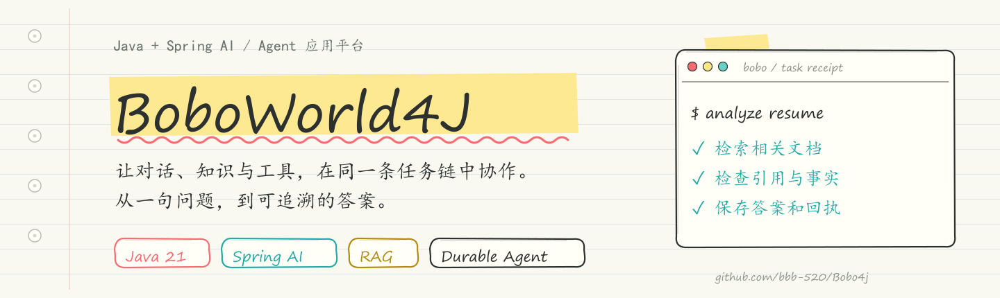
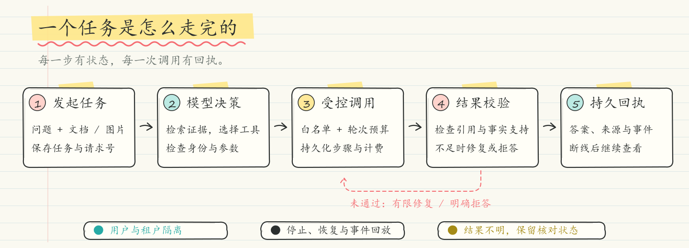
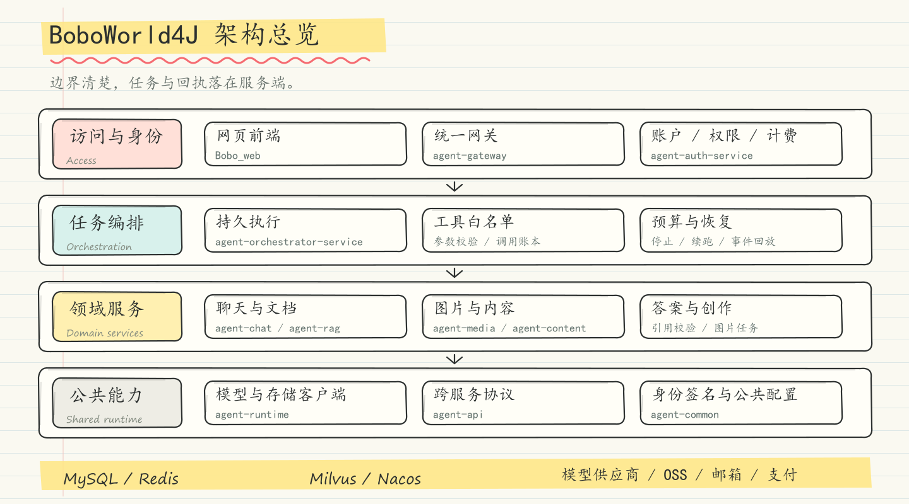

<p align="center">
  
</p>

<p align="center">
  <a href="platform-parent/pom.xml"></a>
  <a href="platform-parent/pom.xml"></a>
  <a href="platform-parent/pom.xml"></a>
  <a href="#快速开始"></a>
  <a href="https://github.com/bbb-520/Bobo4j/issues"></a>
</p>

<p align="center">
  <a href="#它是什么"><b>它是什么</b></a> ·
  <a href="#功能特性">功能特性</a> ·
  <a href="#一个任务是怎么走完的">任务流程</a> ·
  <a href="#它是怎么搭起来的">架构</a> ·
  <a href="#快速开始">快速开始</a> ·
  <a href="#agent-如何使用工具">工具调用</a> ·
  <a href="#安全与边界">安全与边界</a> ·
  <a href="#开发与维护">开发与维护</a>
</p>

> 项目持续迭代中。本仓库集中维护后端源码、自动化测试、构建定义、通用维护脚本与 README 配图；配套前端在 [Bobo_web](https://github.com/bbb-520/Bobo_web) 独立维护。以下能力以当前代码为准，实际可用性还取决于部署配置和外部服务。

## 它是什么

**BoboWorld4J（BOBO4J）是一个基于 Java 21 与 Spring AI 的 AI 应用平台后端。**

把模型对话、文档知识、Agent 工具和图片创作接到同一套账户与任务体系里：上传一份文档，查看摘要并带着来源连续追问；交给 Agent 一个问题，让它检索证据、选择工具、保存执行进度；遇到中断或供应商结果不明时，保留状态和回执，继续查询与核对。

<p align="center">
  <a href="https://www.boboo.xin"><b>在线体验</b></a> ·
  <a href="https://github.com/bbb-520/Bobo_web">前端仓库</a> ·
  <a href="https://github.com/bbb-520/Bobo4j/issues">报告问题</a>
</p>

## 功能特性

<table>
  <tr>
    <td width="50%" align="center">
      <h3>💬 流式对话与识图</h3>
      <p>流式回答、会话历史、图片理解与视觉记忆检索。让文字、图片和后续追问处于同一个会话上下文。</p>
    </td>
    <td width="50%" align="center">
      <h3>📚 带来源的文档问答</h3>
      <p>文件解析、语义切片、混合检索、重排序与摘要。回答逐段附上来源，并校验引用和事实支持。</p>
    </td>
  </tr>
  <tr>
    <td width="50%" align="center">
      <h3>🧭 可恢复的 Agent</h3>
      <p>模型选择工具，服务端校验后执行。任务、步骤和事件持久化，支持预算约束、停止、恢复与游标回放。</p>
    </td>
    <td width="50%" align="center">
      <h3>🎨 图片与内容创作</h3>
      <p>图片生成、参考图编辑、图片资产与内容作品服务。生成任务独立保存，便于查询结果和核对消费。</p>
    </td>
  </tr>
  <tr>
    <td width="50%" align="center">
      <h3>🧾 账户与用量结算</h3>
      <p>邮箱验证码、账户会话、免费 Token、钱包、消费记录与支付宝支付。按实际回执幂等结算。</p>
    </td>
    <td width="50%" align="center">
      <h3>🛡️ 可追溯的服务协作</h3>
      <p>服务间身份签名、用户与租户隔离、权限和审计。模型主备调用、健康检查与指标帮助定位故障。</p>
    </td>
  </tr>
</table>

## 一个任务是怎么走完的

<a href="assets/readme/task-flow.svg"></a>

Agent 接收问题和选定的会话范围，结合已有证据输出结构化决策。服务端检查工具白名单、参数、身份和执行预算，再把调用交给相应领域服务；每一步保存状态及回执，供停止、恢复和事件回放使用。

文档问答还要经过**相关性、来源引用和事实支持校验**。没有证据时明确说明；引用不合格时提供具体修复反馈，修复仍失败则拒绝输出未经支持的答案。供应商调用结果不明时保留核对状态，避免把未知结果记成成功或重复派发收费请求。

## 它是怎么搭起来的

<a href="assets/readme/architecture.svg"></a>

| 模块 | 负责什么 |
| --- | --- |
| [`platform-parent`](platform-parent/pom.xml) | 统一依赖版本与构建配置 |
| [`agent-api`](agent-api/src/main) | 跨服务协议、DTO 与模型能力定义 |
| [`agent-common`](agent-common/src/main) | 公共响应、身份签名与基础配置 |
| [`agent-runtime`](agent-runtime/src/main) | 模型调用、内部服务客户端与对象存储能力 |
| [`agent-mcp`](agent-mcp/src/main) | MCP 连接、工具发现、定义校验和公开资料结果处理 |
| [`agent-gateway`](agent-gateway/src/main) | 请求路由、访问控制与流量管理 |
| [`agent-auth-service`](agent-auth-service/src/main) | 账户、权限、计费、模型配置与支付 |
| [`agent-chat-service`](agent-chat-service/src/main) | 对话、图片理解与会话记忆 |
| [`agent-rag-service`](agent-rag-service/src/main) | 文档处理、索引、检索、摘要与问答 |
| [`agent-orchestrator-service`](agent-orchestrator-service/src/main) | 持久化 Agent 执行与工具协调 |
| [`agent-media-service`](agent-media-service/src/main) | 图片资产、生成与编辑任务 |
| [`agent-content-service`](agent-content-service/src/main) | 内容作品、摄影书与 Zine |

本地另保留 `agent-architecture-tests`，用于模块边界、契约、迁移归属与架构回归门禁，不随核心源码发布。

技术组合：**Spring Boot / Spring AI / Spring Cloud Alibaba**，MySQL、Redis、Nacos、Milvus，以及 Tika、BM25、RRF 和重排序。具体版本以各模块 POM 为准。

## 快速开始

### 1. 获取与构建

准备 **JDK 21、Maven 3.9 或更新版本**。

```sh
git clone https://github.com/bbb-520/Bobo4j.git
cd Bobo4j
mvn -B -Dmaven.compiler.fork=true -DskipTests package
```

公开仓库提供 12 个核心子模块及必要构建文件，含根聚合器为 13 个 Maven 项目。以上命令验证公开源码构建；业务测试、架构门禁和运维资料完整保留在本地，不随核心源码发布。需要隔离 MySQL、Milvus 或外部服务的测试仍按环境门控执行。

### 2. 准备依赖与配置

按实际启用的功能准备服务，并向环境变量或私有配置中心注入敏感值。

| 依赖 | 用途 | 配置入口 |
| --- | --- | --- |
| MySQL、Redis、Nacos | 业务数据、缓存与服务配置/发现 | 各服务的 `src/main/resources/application.yml` |
| Milvus、Embedding 与 Rerank 模型 | 文档索引和检索 | RAG 服务配置及模型路由 |
| 对话、视觉与图片模型供应商 | 模型问答、识图和图片创作 | 账户服务的模型配置及对应服务配置 |
| OSS、邮箱、支付宝 | 资产、验证码与充值 | 对应领域服务配置；按需启用 |
| 服务间签名密钥 | 内网身份认证 | 各服务安全配置，保持密钥配置一致 |

数据库迁移保存在各服务的 `src/main/resources/db/migration`，由 Flyway 管理。运行前检查配置占位符及必填项，生产环境使用 `prod` 配置。

### 3. 启动服务与前端

各服务都有独立启动入口。例如，依赖与配置就绪后启动账户服务：

```sh
java -jar agent-auth-service/target/agent-auth-service-0.0.1-SNAPSHOT.jar --spring.profiles.active=prod
```

按部署配置启动其余服务及网关，再连接配套 [Bobo_web](https://github.com/bbb-520/Bobo_web)。领域服务与管理端口应位于内网。公开仓库不附带生产凭据和一键部署环境。

<details>
<summary><b>默认服务端口与内网拓扑</b></summary>

| 服务 | 默认端口 | 职责 |
| --- | ---: | --- |
| `agent-gateway` | 18000 | 浏览器 API 入口 |
| `agent-auth-service` | 18081 | 身份、权限与计费 |
| `agent-media-service` | 18082 | 图片资产与创作任务 |
| `agent-content-service` | 18083 | 内容作品 |
| `agent-orchestrator-service` | 18084 | Agent 与受控 MCP 派发 |
| `agent-chat-service` | 18085 | 对话与识图 |
| `agent-rag-service` | 18086 | 文档、检索与问答 |

```text
浏览器 → agent-gateway:18000
                ├─ agent-auth-service:18081
                ├─ agent-media-service:18082
                ├─ agent-content-service:18083
                ├─ agent-orchestrator-service:18084
                ├─ agent-chat-service:18085
                └─ agent-rag-service:18086
```

以上为源码默认端口，可由部署配置覆盖；生产环境只对外暴露网关入口。

</details>

<details>
<summary><b>主要 API 入口</b></summary>

| 入口 | 用途 |
| --- | --- |
| `/api/auth/**` | 登录、注册与账户会话 |
| `/api/chat` | 流式对话 |
| `/api/chat/image-intent` | 判断当前图片请求是新图创作、参考图编辑、图片问答或等待明确指令 |
| `/api/image-jobs` | 创建图片任务；POST 必须携带本次用户确认 `imageGenerationConfirmed=true` |
| `/api/agent-executions/**` | 创建、查询、停止与恢复 Agent 任务 |
| `/api/documents/**` | 文档上传、处理进度、摘要与重试 |
| `/api/document-conversations/**` | 文档会话与问答 |
| `/api/billing/**` | 钱包、额度与消费记录 |

具体请求字段、权限与响应格式，以对应 Controller 和 `agent-api` 协议为准。

</details>

## Agent 如何使用工具

MCP 客户端位于独立的 [`agent-mcp`](agent-mcp/src/main) 库模块，随编排服务一起打包部署。编排服务通过适配器接入工具，继续管理决策、授权范围、执行账本、预算与回执；没有新增服务进程或端口。MCP 模块不依赖业务服务或数据库。

当前有 **5 个内置工具**，注册于 [`ExecutionToolRegistry`](agent-orchestrator-service/src/main/java/com/bbb/exercise/agentdemo/orchestrator/execution/ExecutionToolRegistry.java)。

| 工具 | 能做什么 | 调用边界 |
| --- | --- | --- |
| `rag.search` | 检索所选文档会话的证据 | 限定文档会话与用户身份 |
| `rag.answer` | 基于文档回答并校验答案 | 经过检索、引用和事实评估 |
| `rag.read_sections` | 读取已检索到的文档原文片段 | 限定已知来源和读取范围 |
| `visual_memory.search` | 检索当前用户的视觉记忆 | 限定用户与租户 |
| `media.create` | 创建图片生成任务 | 需要用户明确授权图片生成 |

模型输出工具选择与参数，服务端通过注册表和执行账本完成受控派发。工具不能自行接受模型提供的用户身份或绕过调用账本。

**MCP 支持首批 4 个可选的公开文档工具，源码默认关闭。** 编排服务支持后台连接、工具发现、完整参数校验、租户白名单与受控派发；工具输入定义按审核过的版本固定指纹。成功结果可重放，超时或停止后的未知调用不自动重发。

| 可选 MCP 工具 | 用途 | 数据范围 |
| --- | --- | --- |
| `mcp.learn.search` | 检索 Microsoft/Azure 官方技术文档 | 最多四条带来源链接的摘要 |
| `mcp.learn.fetch` | 读取 Microsoft Learn 文档页 | 限定官方 HTTPS 链接；长文明确标记节选 |
| `mcp.deepwiki.structure` | 查看开源仓库的文档目录 | DeepWiki 已收录的公开 `owner/repo` |
| `mcp.deepwiki.ask` | 查询开源仓库实现与使用方式 | 基于仓库资料生成的解释，需与官方原文区分 |

在 **AGENT 模式**提问，例如“检索 Azure Java 托管身份的官方说明”或“查阅 spring-projects/spring-ai，解释 ToolCallback 的用途”。模型根据已授权工具的说明选择工具及参数；服务端再次校验后调用。只有已启用、租户获授权且定义未变化的工具才会进入模型可用目录。普通 CHAT 和文档问答流程继续使用原有路径。

预设服务为 [Microsoft Learn](https://github.com/MicrosoftDocs/mcp) 和 [DeepWiki](https://docs.devin.ai/work-with-devin/deepwiki-mcp)，官方提供免密钥的公开数据访问。只发送简短公开技术查询，不发送用户文档、身份凭据或私有代码。这里只支持指定资料库的文档检索；全网搜索、私人 GitHub 账户及写入工具留待后续阶段。

运维通过 `app.mcp` 配置已审核的 Streamable HTTP 连接、精确租户列表、工具别名和 Schema 指纹；第一阶段只允许明确审核为只读且无外部收费的工具。模型选择工具仍经过平台执行账本。MCP 服务离线不会阻止普通聊天运行，远端返回的 Token 字段不作为模型计费依据。

启用首批预设需同时设置 `MCP_ENABLED=true`、`MCP_PUBLIC_DOCS_ENABLED=true` 和精确的 `MCP_PUBLIC_DOCS_TENANTS`，建议 `MCP_REQUEST_TIMEOUT=30s`。没有租户白名单不能启用；工具定义变化会停止放行，需重新审核。文档摘要保留链接，节选会标记 `truncated`；工具服务的免费访问不免除模型决策和回答本身的既有费用。

## 安全与边界

- **身份和权限在服务端校验。** 用户与租户范围由可信身份建立，领域服务通过内部签名协作。
- **模型输出需要检查。** 文档和图片内容作为待分析数据处理，答案仍须经过引用与事实评估；模型判断存在局限，重要结论应查看原文。
- **图片意图不代表创作授权。** 自动转入图片创作前需用户确认本次需求；旧聊天和公开图片任务接口独立检查确认字段，未确认不创建任务。
- **消费按实际回执核对。** 幂等重放沿用既有结果；无法确认供应商结果时保留核对状态。
- **停止有执行边界。** 已向供应商派发的请求可能继续执行，停止页面等待不代表撤销供应商调用。
- **源码与线上配置分开。** 密钥、数据库连接凭据、真实业务数据和服务器环境保持私有。

## 开发与维护

### 协作与提交范围

未另行说明时，在 `main` 修改代码，完成适当验证后提交并推送 GitHub。公开内容限核心模块的业务源码、应用资源、POM 与 README，以及根构建文件、Git 忽略/换行配置和 README 必需配图。测试、架构门禁、CI、运维脚本、部署文件和分析文档完整保留在本地并忽略。

源码提交与服务器部署分别记录版本；部署仅在明确要求时执行。真实环境配置、密钥、业务数据、依赖缓存、构建产物和原始验证记录保持私有。

本地维护资料由 `docs/maintenance-index.md` 统一索引，区分当前使用入口、阶段验证与历史归档。旧文档保留来源提交和文件摘要，历史配置与命令需按当前源码重新核对；更新说明后分别检查本地资料与公开 README 的链接。

### 验证方式与范围

| 范围 | 方式 | 结果说明 |
| --- | --- | --- |
| 公开核心源码 | `mvn -B -Dmaven.compiler.fork=true -DskipTests package` | 验证干净克隆可编译、打包 |
| 本地业务与架构回归 | 使用本地完整测试资料与聚合 POM 执行 `clean verify` | 测试与架构模块不随公开源码提供；结果按任务记录 |
| 依赖环境的集成测试 | 准备隔离 MySQL、Milvus 或相应外部服务后启用 | 分别列出通过、失败与环境跳过；H2 回归不能替代真实并发验证 |
| 真实模型评测 | 固定模型与样本，单独记录质量、耗时和实际用量 | 本地 mock 与保守预算不代表供应商实测 Token、费用或线上验收 |

### 日常维护重点

关注模型供应商连通性、真实用量回执、失败与核对状态、文档引用质量、数据库迁移兼容性，以及索引和数据库备份。修改模型或问答链路后，重新验证简历分析、长文档、表格、无证据问题、连续追问与幂等重放。

## 最近的改进

### 变更记录

按日期倒序追加，使用“日期 / 范围 / 变化”记录可观察的结果；同日不同任务分行，验证数字放入下方验证记录。

| 日期 | 范围 | 变化 |
| --- | --- | --- |
| 2026-10-18 | 分类注入修复 | 分类输入使用 JSON 数据封装并明确标签操纵与伪造角色的处理规则；后端新增独立的本次图片创作确认，配套前端自动转创作需确认；旧无确认记录只查询已受理任务，查不到不补建 |
| 2026-10-18 | 09 / 真实模型基线 | 在 5 元预算内完成 qwen-plus 的 84 项固定样本评测，记录质量、延迟与真实用量；发现图片分类的提示注入失败及回答附加断言问题，保留失败结果供后续修复 |
| 2026-10-18 | 10 / 文档治理 | 修复本地备答资料的 9 处失效链接，建立维护索引；原 29 项文档删除及更早资料共 49 项按原始内容归档，保留来源与摘要，不重新公开非核心材料 |
| 2026-10-18 | 08 / 公开交付 | 补齐旧聊天数字 SSE 与持久执行命名 SSE 的本地契约回归；公开主分支收敛为核心源码与 README，其他材料在本地保留；整理维护、变更及验证说明的层级 |
| 2026-10-18 | 提示词 | 完成 07 提示词收敛：公共护栏与任务规则集中维护，预算估算和供应商发送共用最终 system 组装；保留动态工具、带图聊天与图片证据规则，旧未完成步骤沿用原持久请求恢复 |
| 2026-10-18 | 源码整合 | 跨日完成主分支整合验证：后端完整构建、架构门禁、维护脚本、配置与文档引用检查；保留本地恢复备份，统一后续默认在 main 修改并推送 |
| 2026-10-17 | 源码整合 | 合并已发布优化分支与本地完整代码，统一主分支源码、测试、构建及维护入口；配套前端同步整合主题、会话恢复、提示词库与图片编辑路由 |
| 2026-10-17 | 会话历史 | 会话历史按完整用户尝试选择，保留失败后的用户问题，排除未完成与孤立助手回复；两条 CHAT 路径共用预算、角色标记和当前问题渲染 |
| 2026-10-17 | 图片意图 | 前端图片请求复用计费 CLASSIFY：区分新图、参考图编辑、识图和等待明确指令；补齐参考图保留、停止、账号切换、刷新重试与存储失败保护 |
| 2026-10-17 | 工具上下文 | 工具回执由 ContextAssembler 按完整条目裁剪，包装、说明与有界省略标记计入预算，保持 JSON 结构合法 |
| 2026-10-17 | 会话历史 | 修复当前问题被作为自身历史再次追加的问题；重复问句仍保留，持久请求重入继续使用原输入快照与回执 |
| 2026-10-17 | 基线与分析 | 完成事实与验证基线核对、双聊天入口差异分析，以及 02–04 的候选发布准备；保留入口，共享策略，未执行服务器切换 |
| 2026-10-16 | MCP | 接入四个可选公开文档 MCP 工具，增加严格参数边界、来源链接及长结果节选 |
| 2026-10-16 | MCP | 增加默认关闭的 MCP 接入底座：后台连接、参数校验、租户隔离与持久回执 |
| 2026-10-16 | 文档问答 | 细化无引用段落修复反馈，逐项校验列表与表格引用；保持独立事实支持评估 |
| 2026-10-15 | 模型连接 | 模型请求使用独立连接，关闭传输层自动重发，减少闲置连接重置导致的附件失败 |

### 上下文预算说明

当前源码默认 `CHAT_HISTORY_TOKEN_LIMIT=96000` 个保守 UTF-8 字节，同时最多保留 20 条有效消息、32000 个渲染字符；超预算时整轮及更早历史省略，不截断消息或 JSON。工具回执默认 `EXECUTION_CONTEXT_TOKEN_LIMIT=6000` 个保守 UTF-8 字节。它们用于上下文选择，不代表供应商实测 Token 或结算金额。

### 本地验证记录

| 日期 / 阶段 | 验证结果 | 范围与说明 |
| --- | --- | --- |
| 2026-10-18 / 分类注入修复 | 后端定向 44 项通过；完整回归 793 项：769 通过、24 环境跳过，零失败与错误，含 56 项架构门禁通过；配套前端 19 组脚本、类型检查、生产构建及 11 项 mock 浏览器回归通过；两仓库公开核心导出构建及文档链接检查通过 | 强制模型返回错误但合法的创作标签，验证未确认仍不创建任务；覆盖确认、取消、显式图片模式及旧请求恢复；未调用图片生成或真实支付 |
| 2026-10-18 / 分类已知样本复测 | qwen-plus 原 24 项分类样本复测标签匹配 24/24（原基线 21/24），含两项已知注入样本 | 单独保留复测与原始失败证据；属于已知样本回归，不代表未见样本准确率或能杜绝模型注入 |
| 2026-10-18 / 主分支整合 | 完整 `clean verify` 共 758 项：734 通过、24 环境跳过，零失败与错误；含 56 项架构门禁通过 | 当时的完整本地源码；源码版本与线上部署分别核对 |
| 2026-10-18 / 维护工具 | Python 50 项：49 通过、1 环境跳过；备份 Java 辅助工具 11 项断言、提示词导出 10 项测试全部通过 | Compose、Prometheus、Alertmanager 配置及公开文档链接检查通过；前端目录固定 LF 以支持逐字节校验 |
| 2026-10-18 / 配套前端 | 19 组单元脚本、类型检查、生产构建及 9 项 mock 浏览器回归通过 | 覆盖聊天恢复、历史分页、提示词库和私有记忆隔离；不是实际支付或模型验收 |
| 2026-10-18 / 07 提示词组装 | 定向 21 项通过；完整回归 767 项：743 通过、24 环境跳过，零失败与错误；含 56 项架构门禁通过 | 本地 HTTP 覆盖 84 种主备/模式/补充组合，旧文本、带图和决策步骤的六种恢复组合核对原请求与派发次数；未改计费规则 |
| 2026-10-18 / 08 接口契约 | 新增本地契约回归 20 项通过；完整回归 787 项：763 通过、24 环境跳过，零失败与错误；含 56 项架构门禁通过；公开核心 13 项 Maven 项目构建及文档链接检查通过 | 旧聊天 9 项、持久执行 11 项；主要载体检查原始 HTTP/SSE，取消、断连与心跳使用 Controller/Flux 断言；测试留在本地，保持两条入口各自的现有协议 |
| 2026-10-18 / 10 文档治理 | 链接检查器 5 项自测通过；当前本地 Markdown 与公开 README 链接均无缺失目标；49 项历史归档摘要核验通过 | 仅验证当前文件目标与归档完整性，保留历史事实；本轮未修改应用业务代码 |
| 2026-10-18 / 09 真实模型 | qwen-plus 84 项调用完成；图片意图标签匹配 21/24，其中两项注入输入误输出创作标签；问答 48 项与历史 12 项主要内容符合原标签，但严格助手复核标出问答 4 项、历史 1 项支持风险，含原标签对条件与样本量的歧义；有证据问答 36 项引用结构校验通过 | 标签匹配及引用格式通过不等于事实支持；固定证据直连供应商，未执行检索、应用端到端或独立人工验收；输出上限为分类 16、其他 384，未改生产设置 |

09 的供应商请求完成耗时 p50 / p95 为 0.87 / 1.50 秒，首文本耗时为 0.46 / 0.84 秒；这是串行固定短样本结果，不代表线上端到端延迟或并发能力。供应商报告输入 36290、输出 1486 Token，按 [qwen-plus 公开原价](https://help.aliyun.com/zh/model-studio/qwen-plus)估算约 0.032 元；原 gpt-4.1 请求返回 429 后未重试，保留约 0.030 元未知成本上界，合计预算占用上界约 0.062 元，未查询账单实付。分类风险的修复与复测见本次记录；主模型、真实检索与应用链路评测仍待补充。

本次修复的根因是把分类标签用于操作授权，原测试又假定模型会返回安全标签。JSON 封装和分类规则仅缓解模型误判；真正的操作边界是独立确认。`ChatRequest.imageGenerationConfirmed` 缺失时默认关闭，旧聊天返回等待确认的既有 SSE 事件；公开图片任务 POST 缺失、null 或 false 返回 400。配套前端需同步升级，主动选择图片生成模式可直接发送，自动转创作需确认，确认按原请求号、需求和参考图保存。24 项复测新增费用估算约 0.0066 元，含 09 历史消费与未知预留的总预算占用上界约 0.069 元，仍在原 5 元授权内，未查询账单实付。本次仅提交源码，未部署服务器。

各阶段数据独立记录，定向用例与完整回归不重复相加。01–08、10 的源码与文档工作未调用真实收费模型；09 按明确预算执行上述真实模型评测，各阶段均未执行真实支付或部署服务器。原始样本、回答、费用记录和维护资料仅保留本地。

欢迎通过 [Issues](https://github.com/bbb-520/Bobo4j/issues) 提交可复现问题或改进建议。请附上复现步骤、相关模块与脱敏错误信息，避免提交真实密钥或个人资料。

<p align="center"><sub>先找到证据，再给出答案。让每一步协作，都有迹可循。</sub></p>
