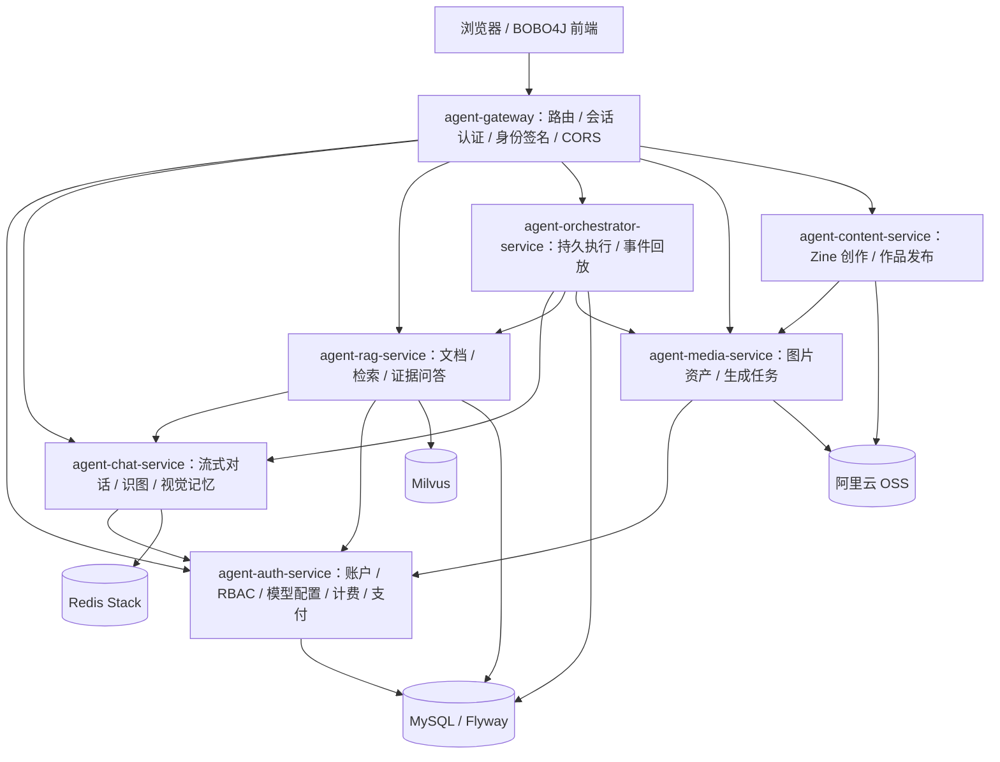

# BoboWorld4J（BOBO4J）

**基于 Java 21 与 Spring AI 的 AI 应用平台后端：流式对话、文档 RAG、可恢复 Agent、图片创作与账户计费。**

BOBO4J 把模型调用、知识检索、工具执行和消费结算拆分为边界明确的服务：用户可以上传文档获取摘要并连续追问；可以让 Agent 完成多步任务，在中途停止、断线后重连，并查看执行进度与引用来源。

本仓库是**后端与基础设施**聚合工程，配套前端为独立仓库 [AgentWebDemo](https://github.com/bbb-520/AgentWebDemo)（React 18 + TypeScript + Vite）。前后端整体统称 **BOBO4J**，源码目录与 Maven 模块名保留 `agent-*` 命名。

## 架构总览



业务入口统一经过网关；`/internal/**` 只用于携带签名的服务间调用，不对外暴露。Nacos 提供注册发现与配置管理，Prometheus 抓取指标，Zipkin 收集调用链，Sentinel 承担流量防护。

```text
浏览器 / BOBO4J 前端
        │  HTTPS / Cookie
        ▼
agent-gateway:18000            # 路由、会话认证、身份签名、CORS
        ├─ agent-auth-service:18081
        ├─ agent-media-service:18082
        ├─ agent-content-service:18083
        ├─ agent-orchestrator-service:18084
        ├─ agent-chat-service:18085
        └─ agent-rag-service:18086
```

### 运行服务与端口

| 服务 | 默认端口 | 职责 |
| --- | ---: | --- |
| `agent-gateway` | 18000 | API 路由、会话认证、可信身份签名、CORS、请求 ID 透传 |
| `agent-auth-service` | 18081 | 用户与邮箱验证码、RBAC、平台模型目录、用户 API Key、钱包、计费与支付 |
| `agent-media-service` | 18082 | 图片上传策略与 OSS 资产、图片生成任务、供应商回执、发布来源 |
| `agent-content-service` | 18083 | Zine 创作生成、Bobo World 作品发布与浏览 |
| `agent-orchestrator-service` | 18084 | 持久任务执行、动态预算、步骤对账、停止 / 继续、事件回放 |
| `agent-chat-service` | 18085 | 流式聊天、图片理解、会话历史、视觉记忆 |
| `agent-rag-service` | 18086 | 文档解析、摘要、混合检索、证据问答与来源校验 |

端口默认值在各自 `application.yml` 的 `server.port` 中声明，可被 `SERVER_PORT`（RAG 为 `RAG_SERVICE_PORT`）覆盖；`infra/nacos/import/agent-*.yml` 与本文档保持一致，并由架构门禁测试强制校验。

## 模块结构

```text
BoboWorld4J/
├─ platform-parent/              # 依赖与版本管理（Spring Boot / Spring AI / Spring Cloud BOM）
├─ agent-api/                    # 跨服务 DTO 与接口契约
├─ agent-common/                 # 身份签名、通用安全与观测约定
├─ agent-runtime/                # 运行时公共能力：模型调用客户端、身份解析、OSS、安全配置
├─ agent-gateway/
├─ agent-auth-service/
├─ agent-chat-service/
├─ agent-rag-service/
│  └─ evaluation/                # 评测语料与采集 / 评估脚本
├─ agent-media-service/
├─ agent-content-service/
├─ agent-orchestrator-service/
├─ agent-architecture-tests/     # 端口、路由、模块边界、迁移归属等架构门禁
├─ infra/                        # Nacos 导入、MySQL、Redis、Milvus、Prometheus、Zipkin
├─ scripts/                      # 构建镜像、导入配置、冒烟与校验脚本
├─ docker-compose.app.yml        # 业务服务组合
└─ Dockerfile.service            # 统一的 JAR 运行镜像
```

支撑模块职责：

| 模块 | 说明 |
| --- | --- |
| `platform-parent` | 统一 BOM 与依赖版本，被全部子模块继承 |
| `agent-api` | 跨服务契约：身份、聊天、模型、RAG、计费 DTO |
| `agent-common` | 仅含无业务归属的公共能力：内部身份签名（`SignedPrincipal`、`PrincipalKeyRing`）、观测与请求 ID |
| `agent-runtime` | 模型调用客户端、身份解析、浏览器安全配置、OSS 存储、权限策略 |
| `agent-architecture-tests` | 不参与运行，只作构建期门禁 |

## 核心能力

| 能力 | 实现内容 |
| --- | --- |
| 对话与识图 | SSE 流式对话、图片理解、会话历史、图片附件、用户与租户身份隔离 |
| 文档 RAG | Tika 多格式解析、语义切片、Milvus 向量索引、Dense + BM25 混合召回、RRF 融合与 Rerank |
| 文档摘要与追问 | 异步入库与摘要、进度查询、固定文档版本的问答会话、可查看的原文引用 |
| Agent 执行 | 模型输出结构化决策，服务端校验后调用白名单工具；动态轮次预算、工具超时、步骤幂等、执行审计 |
| 停止与恢复 | 持久化任务与事件，显式停止、版本控制的继续执行、SSE 游标回放 |
| 模型兜底 | 主模型超时或可重试异常时最多尝试一次备用模型；失败保留明确状态、已有内容与调用回执 |
| 模型工作标识 | 显示实际供应商 / 型号、兜底标识，以及处理、完成、失败、停止、等待状态 |
| 图片与内容 | OSS 直传策略、图片生成任务、Zine 创作与 Bobo World 作品发布 |
| 账户与支付 | QQ 邮箱验证码、Cookie 登录、注册赠送免费 Token、钱包与消费记录、支付宝及微信扫码充值 |
| 账户治理 | RBAC 角色与权限、操作审计、用户禁用、模型调用组对账 |
| 可观测性 | Actuator、Micrometer、Prometheus 指标与告警、Zipkin 调用链 |

## 技术栈

版本以 `platform-parent/pom.xml`、各模块 `pom.xml` 与 Compose 配置为准。

| 层次 | 技术 |
| --- | --- |
| 后端 | Java 21、Spring Boot 4.1.1、Spring AI 2.0.1、Spring WebFlux / Reactor |
| 微服务 | Spring Cloud 2025.1.0、Spring Cloud Alibaba 2025.1.0.0、Gateway、Nacos 3.1.1、Sentinel |
| 数据与迁移 | MySQL 8.4、Spring JDBC、MyBatis-Plus（Spring Boot 4 Starter）、Flyway、Redis Stack 7.4 |
| 文档与检索 | Apache Tika 3.3.2、Milvus Server 2.6.2 / Java SDK 2.6.4、BM25、RRF |
| 模型 | ChatGPT 主模型、千问兜底；默认 Embedding 为 `text-embedding-v4`，向量维度 1024 |
| 对象存储与支付 | 阿里云 OSS SDK、JavaMail（QQ SMTP）、支付宝 SDK、微信支付 Native API v3 |
| 部署与监控 | Docker / Compose、Prometheus 3.4.2、Zipkin 3.5.1、Sentinel Dashboard |
| 验证 | JUnit 5、Spring Boot Test、Testcontainers、H2、ArchUnit 风格架构门禁 |

## RAG 工作链路

1. 用户以幂等请求 ID 上传文档，原件落到文档存储卷，入库任务异步执行。
2. Tika 提取文本，按内容边界切成片段并保留文档版本、标题、段落与原文范围；执行语义切分与 Embedding。
3. 向量写入 Milvus，文档与切片元数据保存在 MySQL；摘要分段生成并汇总，提供状态与覆盖率。
4. 问答会话固定选中文档及其索引版本；多轮追问根据已提交历史改写检索问题。
5. 检索在**同一授权范围内**并行执行两路召回：Milvus Dense（HNSW / COSINE）与应用层关键词路，两者经 RRF 融合（`1/(60+rank)` 加权），再由 Rerank 模型按分数阈值筛选证据。
6. 模型基于证据作答；引用校验、事实支持与相关性评估共同约束结果，无充分证据时明确说明。

索引以 `tenant_id + user_id + document_id + index_version + embedding_fingerprint` 作为服务端过滤条件，配合 `embedding_fingerprint` 隔离不同 Embedding 模型，避免跨模型向量混用。当前支持带文本层的 PDF、Office、HTML、Markdown 和纯文本，单文件上限 100 MiB，不包含扫描件 OCR。`agent-rag-service/evaluation` 提供离线评测语料与脚本，用于区分召回缺失、排序不佳与回答不忠实。

## Agent 引擎

执行采用**双循环**结构：

- **外循环**（持久、数据库驱动、可跨重启）：`ExecutionWorker` 通过定时轮询领取任务租约（含租约续期），先对账未完成的付费步骤，再逐轮推进；使用虚拟线程与有界并发执行。
- **内循环**（单次租约内的决策-工具循环）：模型只输出结构化 JSON 决策，服务端校验参数后派发白名单工具，直到任务完成或进入等待。

**工具白名单**（服务端硬编码，模型不能自定义工具）：

```text
rag.search, rag.answer, rag.read_sections, visual_memory.search, media.create
```

决策参数被严格限制：禁止携带身份字段（如 userId / tenantId / owner / filter），参数数量与体积有上限；`media.create` 需显式开启图片生成，`rag.read_sections` 只能读取此前已检索到的文档。

**预算与状态**：初始预算 4 轮，有有效进展时按 4 轮扩展；硬上限为 64 轮、128 次工具调用、64,000 Token 与 30 分钟活动时间。无进展进入 `NEEDS_INPUT`，预算或额度不足进入等待状态，恢复执行不会清零累计消耗。任务状态集合包括 `QUEUED / RUNNING / STOPPING / STOPPED / COMPLETED / FAILED / WAITING_FOR_BUDGET / WAITING_FOR_RECONCILIATION / NEEDS_INPUT`。

**停止与恢复**：停止 SSE 订阅只断开连接，停止持久任务必须调用 `/stop`。恢复使用 `expectedVersion` 做乐观锁，防止并发覆盖。任务、工具步骤与事件写入 MySQL，步骤以稳定调用 ID 与回执恢复，避免刷新、重连或重启造成重复派发。执行事件 ID 为 `executionId:seq`，可通过 `Last-Event-ID` 或 `after` 回放遗漏事件，事件过期时返回 `410`。

## 多模态与视觉记忆

- **图片理解**：`agent-chat-service` 通过模型客户端的 `VISION` 模式携带图片理解问题，产出场景卡事件；单次消息最多附带 1 张图片。
- **视觉记忆**：`agent-chat-service` 在 MySQL `vision_memory` 表中保存场景摘要（主体、配色、构图、情绪、用户指令），召回采用确定性的**词法检索 + 时间衰减**打分（非向量检索），通过 `/api/settings/visual-memory/context` 对外提供上下文。
- **图片生成**：`agent-media-service` 管理上传资产与生成任务，任务异步执行并保存供应商回执；`agent-content-service` 基于可信的图片任务生成 Zine，并发布为 Bobo World 作品。

## 模型路由与兜底

ChatGPT / OpenAI 是聊天、图片理解与文档生成的主模型，千问为可重试失败的兜底模型。默认型号均可通过后端环境变量配置：

| 能力 | 默认主模型 | 兜底 / 配置说明 |
| --- | --- | --- |
| 聊天、文档摘要与问答 | ChatGPT `gpt-4.1` | 千问 `qwen-plus`，最多一次 |
| 图片理解 | ChatGPT `gpt-4.1` | 千问 `qwen-vl-plus`，携带原图片与问题 |
| 证据校验、Agent 决策 | ChatGPT `gpt-4.1` | 保持评估与结构化决策约束，不自动兜底 |
| 文档向量、重排序 | 千问 `text-embedding-v4`、`qwen3-rerank` | 重排序须配置账号所在区域 / 工作空间的地址 |
| 图片创作 | 千问 `qwen-image-3.0-pro` | 走图片任务流程 |

配置入口为环境变量（如 `OPENAI_API_KEY`、`QWEN_API_KEY`、`PLATFORM_CHAT_MODEL`、`PLATFORM_RERANK_BASE_URL` 等），由 `agent-auth-service` 读取并统一分发给其他服务；模型密钥仅由后端使用，不进入前端配置。更换 Embedding 模型时须保持维度一致并重建索引。

**工作状态上报**：普通对话与图片理解使用 SSE 事件 `MODEL_STATUS`，持久任务使用 `model_status` 事件并在任务快照中保存当前 `modelStatus`。内容包含 `provider`、`model`、`capability`、`state`、`fallback`，不含密钥、凭据指纹或上游地址；状态为 `RUNNING` / `SUCCEEDED` / `FAILED`。前端据真实事件显示供应商、型号与状态，不按配置预先假定。

**超时默认值**：首段 15 秒、空闲 20 秒、总 60 秒；备用调用 30 秒。已达派发但消费未知的调用进入待对账状态，不承诺供应商撤销或免费重复调用。

## API 概览

API 基址为网关的 `/api`。普通接口返回 JSON，对话与执行事件返回 `text/event-stream`。契约定义见 `agent-api` 与各模块控制器。

| 方法 | 路径 | 用途 |
| --- | --- | --- |
| POST | `/api/auth/email/code` | 发送 QQ 邮箱验证码，`purpose` 为 REGISTER / LOGIN / BIND |
| POST | `/api/auth/register`、`/api/auth/login`、`/api/auth/email/login` | 注册、密码登录、验证码登录 |
| POST | `/api/auth/email/bind` | 当前账号绑定邮箱 |
| GET / POST | `/api/auth/me` / `/api/auth/logout`、`/api/auth/csrf` | 当前账户 / 登出 / CSRF |
| GET | `/api/settings/models`、`/api/settings/models/catalog` | 平台模型目录与按能力选择的模型 |
| GET / PUT / DELETE | `/api/settings/keys` | 平台统一托管模型凭据状态的查询 |
| GET | `/api/admin/users`、`/roles`、`/permissions`、`/audits` | RBAC 用户、角色、权限与审计 |
| PUT | `/api/admin/users/{user}/status`、`/users/{user}/roles`、`/roles/{code}` | 用户禁用、角色授予、角色维护 |
| POST | `/api/chat`（别名 `/api/chat/completions`） | 对话 SSE，字段为 `question`、`sessionId`、`attachments` |
| GET | `/api/settings/visual-memory/context` | 视觉记忆召回上下文 |
| POST / GET | `/api/documents` | 上传文档 / 文档列表 |
| GET | `/api/documents/{id}`、`/documents/{id}/summary`、`/documents/{id}/sources/{chunkId}` | 入库状态 / 摘要 / 原文引用切片 |
| POST | `/api/documents/{id}/retry` | 重试失败的文档任务 |
| POST / GET | `/api/document-conversations`、`/api/document-conversations/{id}` | 以 `documentIds` 创建问答会话 / 固定版本与历史 |
| GET | `/api/document-conversations/{id}/retrieval-traces` | 检索过程追踪 |
| POST | `/api/agent-executions` | 创建 CHAT / AGENT / DOCUMENT_QA 持久任务 |
| GET | `/api/agent-executions/{id}`、`/api/agent-executions?requestId=` | 查询任务状态、答案、预算与版本 |
| GET | `/api/agent-executions/{id}/events` | 带事件 ID 的 SSE 订阅与回放 |
| POST | `/api/agent-executions/{id}/stop`、`/resume` | 停止 / 继续任务 |
| POST / GET | `/api/agent-runs`、`/api/agent-runs/{id}` | REVISE 工作流的持久状态机（草稿→评审→修订→校验→通过/驳回） |
| POST | `/api/agent-runs/{id}/advance` | 推进工作流状态 |
| POST | `/api/image-assets/upload-policy`、`/api/image-assets/{assetId}/complete` | 获取受限的 OSS 直传策略 / 完成校验 |
| POST / GET | `/api/image-jobs`、`/api/image-jobs/{jobId}` | 创建图片生成任务 / 查询与下载 |
| POST | `/api/zine/generate` | Zine 创作生成 |
| POST / GET / PATCH / DELETE | `/api/bobo/items`、`/api/bobo/items/mine`、`/api/bobo/items/{itemId}` | 作品发布 / 我的 / 详情、可见性修改、删除 |
| GET | `/api/bobo/world` | 公开作品浏览（游标分页） |
| GET | `/api/billing/wallet`、`/api/billing/usage`、`/api/billing/events` | 钱包 / 消费明细 / 余额变更 SSE |
| POST / GET | `/api/payments/orders`、`/api/payments/orders/{id}` | 创建扫码充值订单 / 查询状态 |

**身份与安全**：登录成功后写入 HttpOnly 会话 Cookie，浏览器请求使用 `credentials: 'include'`。网关在转发前**剥离客户端自报的全部身份头**（如 `x-user-id`、`x-tenant-id`、`x-roles` 等及 `x-principal*` 前缀），改由服务端解析身份；服务间调用使用有效期 60 秒的 `X-Internal-Principal` HMAC 签名头（含 service、audience、operation，支持密钥轮换）。支付回调与登录相关路径为公开端点，其余需登录。用户和租户身份由服务端解析，客户端不能通过自填身份头指定其他用户。

**错误语义**：

| 状态 | 常见含义 |
| --- | --- |
| 401 / 403 | 未登录或无权访问资源 |
| 402 | 欠费或可用消费额度不足 |
| 409 | 幂等参数冲突、版本冲突、并发调用或消费待对账 |
| 410 | 已退役接口或事件流已过期 |
| 413 | 上传超过大小限制 |
| 502 / 503 | 上游服务失败或能力尚未配置 |

SSE 已开始后还需检查流内错误事件与最终任务状态，不能只看 HTTP 200。

## 计费与数据一致性

新注册账户一次性获得 1,000,000 免费 Token；按真实输入、输出 Token 消耗结算，优先扣免费额度。剩余额度偏低时通过事件与页面提醒；欠费状态阻止继续调用。没有 Token 用量的图片按图片规则结算。

内部金额使用整数微元，1 元 = 1,000,000 微元。预授权、派发、供应商回执、结算与退款通过事务与幂等约束关联；未知消费保留占用并等待对账。默认故障成本政策为单调用组上限 600,000 微元、窗口上限 2,000,000 微元、待对账尝试上限 10（内部预授权成本上限，不代表供应商报价）。站内消费退款不等于支付渠道原路退款。

MySQL 各服务使用独立 Flyway history（`flyway_schema_history_<service>`），互不干扰；Redis 保存会话记忆，Milvus 保存文档向量，文档原件与基础设施数据使用独立持久卷。

## 开发与验证

后端需要 JDK 21 与 Maven；前端为独立仓库，需要 Node.js 22。完整启动步骤、模型切换以及 OSS、SMTP、支付配置保存在本地 `HELP.md`（该运维文档不随本仓库提交），真实 `.env`、密钥文件与证书均不入仓。

```bash
# 后端完整构建与验证（含架构门禁）
mvn -Dmaven.compiler.fork=true verify

# 仅运行架构契约测试：README 端口、模块默认端口、路由与配置一致性
mvn -pl agent-architecture-tests -am -Dmaven.compiler.fork=true test
```

架构门禁会在构建期强制以下事实保持一致：README 端口表与各模块 `application.yml` 默认端口、Nacos 导入配置、网关路由目标、迁移归属、控制器与持久层边界等。容器基础设施相关测试需要 Docker，并按环境开关启用。文档评测入口为 `agent-rag-service/evaluation`，真实采集会调用模型，结论须区分语料检查、自动评估与人工标注。

## 项目边界

- 默认部署是单机多容器方案，不能据此声称已具备高可用、集群灾备或无限任务执行能力。
- 模型、OSS、邮箱与支付需要各自凭据，服务启动就绪不等于外部能力已验证。
- 文档证据检查与模型兜底可减少失败与不忠实回答，但无法保证每次生成绝对正确。
- 本 README 描述当前源码实现；生产环境应使用一致版本的前后端，并在改动后重新打包与构建镜像。
