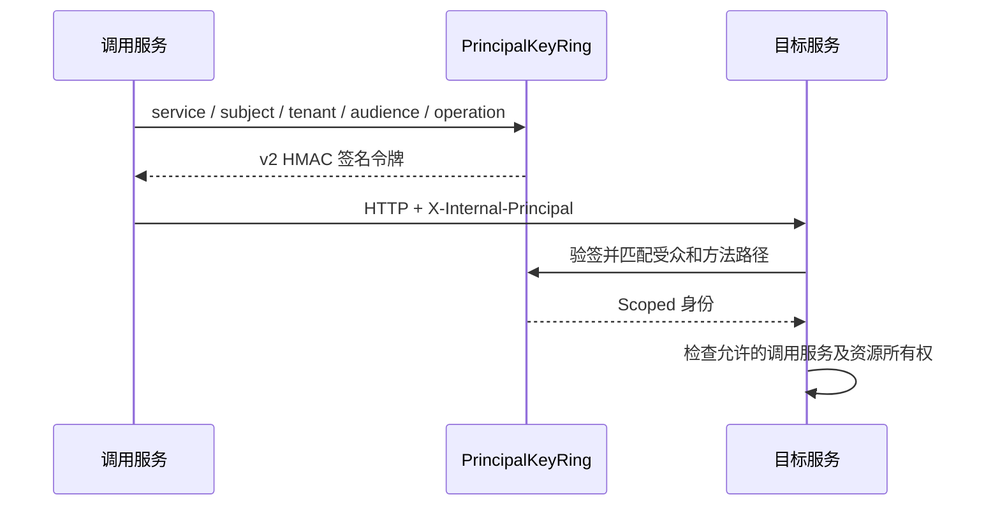

# agent-common 模块帮助文档

## 1. 模块作用

本模块提供没有业务归属的公共能力：API 响应值、请求 ID、内部服务身份签名、密钥轮换和 HTTP 观测约定。它是普通库，没有业务 Controller、数据库实体、迁移脚本或独立端口。

与 [agent-api](../agent-api/README.md) 的区别是本模块提供通用实现；与 [agent-runtime](../agent-runtime/README.md) 的区别是本模块不承载 OSS、浏览器授权、模型调用等应用运行时组件。Gateway 依赖 Common，而无需引入完整 Runtime。

## 2. 代码结构

| 位置 | 主要类 | 功能 |
| --- | --- | --- |
| [api](src/main/java/com/bbb/exercise/agentdemo/common/api) | `ApiResponse`、`ApiError` | 成功 / 失败响应的数据结构 |
| [trace](src/main/java/com/bbb/exercise/agentdemo/common/trace) | `RequestId` | 接受有效请求 ID，或生成 UUID |
| [security](src/main/java/com/bbb/exercise/agentdemo/common/security) | `SignedPrincipal`、`PrincipalKeyRing` | 内部调用签名、验签和活动密钥选择 |
| [observability](src/main/java/com/bbb/exercise/agentdemo/common/observability) | `ServiceClientObservations` | 限制内部 HTTP 指标 URI 标签基数 |
| [application-common.yml](src/main/resources/application-common.yml) | 公共配置资源 | Nacos 导入、MyBatis 和管理端点配置素材 |

`ApiResponse.success(data)` 与 `failure(code, message)` 是可选封装，当前服务也存在直接返回 record、Map 或 SSE 的接口，不能假设全项目所有响应都套这一层。

## 3. 内部签名如何工作



[SignedPrincipal](src/main/java/com/bbb/exercise/agentdemo/common/security/SignedPrincipal.java) 使用 HMAC-SHA256，对包含版本、key ID、调用服务、用户主体、租户、受众、操作、签发时间和到期时间的 payload 签名。payload 和签名采用 Base64URL 编码。

令牌有效期为 60 秒；验签拒绝过期、有效期过长、超出允许时钟偏差、错误受众或错误操作的令牌，并使用恒定时间比较签名。`operation` 通常是 `HTTP方法 + 空格 + 请求路径`，签名与验签必须采用一致表示。

签名提供完整性和来源验证，**不加密 payload，也不自动完成资源授权**。内部 Controller 还需要检查调用服务白名单、用户、租户和资源范围；此协议也不等同于一次性 nonce 防重放机制。

## 4. 密钥配置和轮换

[PrincipalKeyRing](src/main/java/com/bbb/exercise/agentdemo/common/security/PrincipalKeyRing.java) 接受：

```text
INTERNAL_PRINCIPAL_SECRETS=current=<Base64编码的至少32字节随机值>,previous=<旧密钥>
INTERNAL_PRINCIPAL_ACTIVE_KEY_ID=current
```

上述为格式说明，占位文字不能直接用于运行。配置中 key ID 不得重复，活动 key ID 必须存在。签名只使用活动密钥，验签接受密钥环中保留的密钥。

轮换时先让所有服务具备新旧两把密钥，再切换活动 key ID；确认旧令牌和在途调用处理完毕后再移除旧密钥。各服务的时钟与签名配置必须一致。

## 5. 请求 ID 和观测

`RequestId.resolve` 保留不为空且长度不超过 128 的输入（会去除首尾空白），否则生成 UUID。它用于关联日志，不代表用户身份，也不能代替各业务自己的幂等键。

`ServiceClientObservations` 提供 `ClientRequestObservationConvention`，把内部 URL 中用户、调用组、文档、资产等资源 ID 归一为 `{id}`，避免每个 ID 生成一条新的指标时间序列。它只修改观测标签，不修改实际 URL 或签名内容；已有自定义 convention 时不覆盖。

POM 引入 WebClient、Prometheus registry 和 Zipkin 相关依赖。`application-common.yml` 作为公共资源存在，引用本 JAR 不代表该 YAML 一定自动生效；以服务自己的配置导入和实际属性层级为准。

## 6. 测试和维护

仓库根目录执行：

```powershell
mvn -pl agent-common -am '-Dmaven.compiler.fork=true' test
```

测试目录（本地路径 `src/test/java/com/bbb/exercise/agentdemo/common`，不随核心源码发布） 覆盖响应封装、签名、观测约定，以及根聚合 POM、配置、部署资产和 Flyway 隔离契约。`InfrastructureContainersTest` 涉及容器环境，应查看该测试的启用条件。

新增 Common 能力时应确认它确实没有业务归属。架构门禁禁止把 Controller、持久化类和服务实现复制到本模块。内部请求出现 401 时优先核对 key ID、密钥、时钟、audience 和 operation，再核对接收端调用服务白名单。
