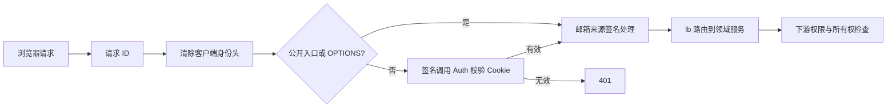

# agent-gateway 模块帮助文档

## 1. 模块作用

Gateway 是浏览器访问后端业务 API 的统一入口，默认端口 `18000`，启动类为 [GatewayApplication](src/main/java/com/bbb/exercise/agentdemo/gateway/GatewayApplication.java)。它通过 Spring Cloud Gateway WebFlux 转发请求，承担路由、入口会话检查、清除不可信身份头、请求 ID 和 CORS。

它不拥有业务表、不执行模型推理，也不通过 Java 依赖直接调用其他服务实现。浏览器权限和资源所有权由下游服务继续验证。

## 2. 请求处理流程



[AuthRelayGlobalFilter](src/main/java/com/bbb/exercise/agentdemo/gateway/filter/AuthRelayGlobalFilter.java) 删除 `X-User-Id`、`X-Tenant-Id`、`X-Internal-Principal`、角色 / 权限头以及 `X-Principal*`。Cookie 保留给下游。网关不会把浏览器自报身份当作可信身份，也不会为浏览器业务请求签发可直接信任的用户头。

[HttpGatewaySessionAuthenticator](src/main/java/com/bbb/exercise/agentdemo/gateway/filter/HttpGatewaySessionAuthenticator.java) 对受保护入口调用 Auth 的 `/internal/auth/session`，该内部请求本身带签名。无 Cookie、无效会话或非成功认证响应不会通过；网络 / 超时异常转换为服务不可用，默认校验超时 3 秒。

过滤器公开名单包含登录、注册、邮箱登录 / 验证码、CSRF、支付回调、部分认证路径和 Actuator；它是入口检查名单，不等于下游免权限或免 CSRF 名单。例如 `/api/auth/me` 到达 Auth 后仍需有效会话。

## 3. 路由表

当前路由全部定义在 [GatewayRoutes](src/main/java/com/bbb/exercise/agentdemo/gateway/config/GatewayRoutes.java)，保留原请求路径，无额外路径前缀剥离：

| 路径 | 目标 discovery 服务名 | 默认服务端口 |
| --- | --- | ---: |
| `/api/auth/**`、`/api/admin/**`、`/api/settings/keys/**`、`/api/settings/models/**`、`/api/billing/**`、`/api/payments/**` | `agent-auth-service` | 18081 |
| `/api/chat/**`、`/api/settings/visual-memory/**` | `agent-chat-service` | 18085 |
| `/api/image-assets/**`、`/api/image-jobs/**` | `agent-media-service` | 18082 |
| `/api/bobo/**`、`/api/zine/**` | `agent-content-service` | 18083 |
| `/api/agent-executions/**` | `agent-orchestrator-service` | 18084 |
| `/api/documents/**`、`/api/document-conversations/**` | `agent-rag-service` | 18086 |

目标 URI 使用 `lb://服务名`，需要 Nacos 注册发现与 LoadBalancer。`/internal/**` 没有公网业务路由；服务间内部调用使用各自的 base URL。

## 4. 邮件来源和跨域

[EmailSourceGlobalFilter](src/main/java/com/bbb/exercise/agentdemo/gateway/filter/EmailSourceGlobalFilter.java) 总是删除外部 `X-Email-Source`，仅对发送验证码接口根据网关看到的远端 IP 签发来源信息，供 Auth 做邮件发送限流。它不直接信任浏览器伪造的转发头；多层代理部署时需要确认网关实际观察到的来源地址。

[GatewayCorsConfiguration](src/main/java/com/bbb/exercise/agentdemo/gateway/config/GatewayCorsConfiguration.java) 读取 `app.cors.allowed-origins`。使用 Cookie 的前端还需要请求携带 credentials，并遵循下游 CSRF 要求，见 [Runtime 文档](../agent-runtime/README.md)。

当前 CORS 方法名单为 GET、POST、PUT、DELETE、OPTIONS，未包含 PATCH。Content 的作品修改使用 PATCH，跨域浏览器预检可能因此被拒绝；同源代理访问与跨域直连的行为需要区分，开放跨域 PATCH 时须同步维护方法名单。

POM 和配置接入 Sentinel；具体限流效果取决于运行时是否配置对应规则，不能仅凭引入依赖就认为所有 API 已具备业务限流策略。

## 5. 关键配置

配置入口：[application.yml](src/main/resources/application.yml)。

| 环境变量 | 默认值 / 用途 |
| --- | --- |
| `SERVER_PORT` | `18000` |
| `NACOS_SERVER_ADDR` | `127.0.0.1:8848`，发现与配置服务 |
| `NACOS_USERNAME` / `NACOS_PASSWORD` | Nacos 认证配置 |
| `AUTH_SERVICE_URL` | `http://127.0.0.1:18081`，入口 Cookie 校验 |
| `INTERNAL_PRINCIPAL_SECRETS` / `INTERNAL_PRINCIPAL_ACTIVE_KEY_ID` | 内部签名密钥环与活动 key ID |
| `SESSION_COOKIE_NAME` | `bbb_agent_session` |
| `DEFAULT_TENANT_ID` | `local` |
| `CORS_ALLOWED_ORIGINS` | 允许的前端 origin 模式列表 |
| `SENTINEL_DASHBOARD` / `SENTINEL_CLIENT_PORT` | Dashboard 地址 / 默认客户端通信端口 8719 |

Nacos 配置导入的 Data ID 为 `agent-gateway.yml`，group 为 `AGENT_GROUP`。其余环境准备见 [infra](../infra/README.md)。

## 6. 构建、运行和验证

```powershell
# 仓库根目录；运行前配置 Nacos、Auth 地址和内部签名
mvn -pl agent-gateway -am '-Dmaven.compiler.fork=true' package
java -jar agent-gateway/target/agent-gateway-0.0.1-SNAPSHOT.jar
```

`java -jar` 是长期运行进程。另开终端运行：

```powershell
Invoke-RestMethod http://localhost:18000/actuator/health
mvn -pl agent-gateway -am '-Dmaven.compiler.fork=true' test
```

[测试目录](src/test/java/com/bbb/exercise/agentdemo/gateway) 覆盖路由服务名、内部路径边界、身份头清理、会话检查和邮件来源签名。

## 7. 常见问题与扩展

- **路由 503**：检查 Nacos 中目标服务是否在线、注册 group 是否匹配；单个 JVM 健康不等于 `lb://` 一定能发现它。
- **登录后 401**：检查浏览器是否发送同名 Cookie，Auth 地址和签名配置是否正确。
- **写接口 403**：检查下游 CSRF 与权限，网关入口校验成功不代表业务授权成功。
- **SSE 看不到增量**：检查前置代理的响应缓冲、读取超时，以及客户端是否按流解析。

新增服务路由时，同时更新路由表、部署端口、Nacos / Prometheus 配置、架构契约，以及下游的 `PermissionPolicy`。保持 Gateway 仅依赖公共契约和 HTTP 服务边界。
