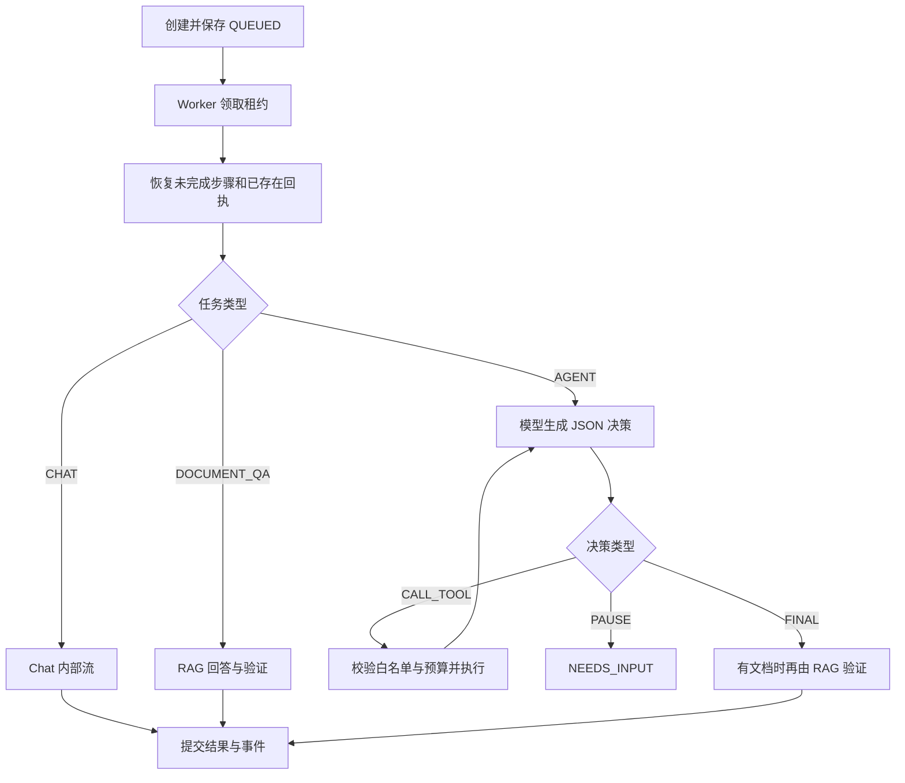

# agent-orchestrator-service 模块帮助文档

## 1. 模块作用

Orchestrator 负责持久任务的创建、排队、步骤执行、预算、停止、继续和事件回放。默认端口 `18084`，启动类为 [OrchestratorApplication](src/main/java/com/bbb/exercise/agentdemo/orchestrator/OrchestratorApplication.java)。

当前包含两套明确不同的入口：`/api/agent-runs` 是 REVISE 工作流状态机；`/api/agent-executions` 是实际调用 Chat / RAG / Media 的持久执行器。前者推进状态不意味着执行器已经完成模型审阅。

## 2. 核心类

| 类 / 目录 | 作用 |
| --- | --- |
| [AgentWorkflowService](src/main/java/com/bbb/exercise/agentdemo/orchestrator/service/AgentWorkflowService.java) | REVISE 工作流的 JDBC 状态转移 |
| [ExecutionController](src/main/java/com/bbb/exercise/agentdemo/orchestrator/execution/ExecutionController.java) | 持久任务 HTTP 和 SSE 回放 |
| [ExecutionStore](src/main/java/com/bbb/exercise/agentdemo/orchestrator/execution/ExecutionStore.java) | 任务、租约、步骤、预算、事件和幂等 |
| [ExecutionWorker](src/main/java/com/bbb/exercise/agentdemo/orchestrator/execution/ExecutionWorker.java) | 虚拟线程执行、模型决策外循环和工具派发 |
| [ExecutionClient](src/main/java/com/bbb/exercise/agentdemo/orchestrator/execution/ExecutionClient.java) | 签名远端调用、超时和流式生成 |
| [ExecutionBudget](src/main/java/com/bbb/exercise/agentdemo/orchestrator/execution/ExecutionBudget.java) | 持久预算和进展判断 |
| [AgentDecision](src/main/java/com/bbb/exercise/agentdemo/orchestrator/execution/AgentDecision.java) | 严格解析模型的单个 JSON 决策 |
| [ExecutionIdentity](src/main/java/com/bbb/exercise/agentdemo/orchestrator/execution/ExecutionIdentity.java) / [auth](src/main/java/com/bbb/exercise/agentdemo/orchestrator/auth) | 会话身份和 Auth 访问 |

## 3. 持久执行如何工作



`ExecutionStore.Create` 包含 `requestId`、`type`、`question`、可选普通 `conversationId`、`documentConversationId` 和 `allowImageGeneration`。创建以身份、请求 ID 和参数一致性实现幂等，客户端重试必须沿用原 requestId。

`ExecutionWorker` 默认每 500ms 轮询，使用虚拟线程，当前并行容量为 4。领取、续租、步骤结果和事件序号由数据库控制，远端 HTTP 调用在数据库事务之外执行。Worker 写入受 lease token / 有效期约束，失去租约的旧执行者不能覆盖继任者。

每个步骤使用稳定 step key、参数哈希和派生 `callId`。已有成功步骤直接复用，未完成付费步骤先向 Auth / RAG 查询结果；不因重启就重新派发未知付费请求。

## 4. 模型决策和工具边界

模型只返回一个 JSON 对象，不直接执行工具，也不输出思维链。`AgentDecision.parse` 只接受：

```json
{"type":"CALL_TOOL","tool":"rag.search","arguments":{"query":"查找验收要求"}}
```

或 `{"type":"FINAL","answer":"完整答案"}`、`{"type":"PAUSE","answer":"需要补充的信息"}`。字段集合、参数数量 / 大小和工具名受严格限制，参数中禁止携带 `userId`、`tenantId`、`owner`、`filter`、`system` 等越权字段。

| 工具 | 实现和约束 |
| --- | --- |
| `rag.search` | 调用内部检索；必须有已选择文档会话 |
| `rag.answer` | 调用带证据验证的文档回答 |
| `rag.read_sections` | 只能读取会话中、且已从检索回执见过的文档，最多 8 段 |
| `visual_memory.search` | 查询当前用户视觉记忆 |
| `media.create` | 必须 `allowImageGeneration=true` 且提供 conversationId；创建 Media 图片任务 |

工具结果只是数据。`media.create` 返回图片任务不意味着图片生成已完成；最终输出应遵循实际工具回执。任务带文档会话时，即使决策为 FINAL，也经 RAG 重新生成 / 验证文档答案。

## 5. 动态预算和暂停原因

初始轮次窗口为 4；有新进展时可以每次自动延长 4 轮。硬上限保存在 ExecutionBudget 中：

| 资源 | 上限 |
| --- | ---: |
| 决策轮次 | 64 |
| 工具调用 | 128 |
| 已使用 + 预留 Token | 64,000 |
| 活跃执行时间 | 1,800,000ms，即 30 分钟 |

重复无进展指纹达到阈值会进入 `NEEDS_INPUT`；预算触顶进入 `WAITING_FOR_BUDGET`。继续执行不会清空累计消费或突破硬上限。钱包 / 模型准入预算与该执行预算不同，两者都需要通过。

## 6. 状态、停止和继续

| 状态 | 含义 / 下一步 |
| --- | --- |
| `QUEUED` | 等待 Worker 领取 |
| `RUNNING` | 正在持有租约执行 |
| `STOPPING` | 已请求停止，等待在途步骤处理 |
| `COMPLETED` | 最终结果已提交 |
| `STOPPED` | 已停止，可按允许状态继续 |
| `NEEDS_INPUT` | 缺信息、无进展或输入不满足工具条件 |
| `WAITING_FOR_BUDGET` | 执行 / 钱包 / 准入预算不足 |
| `WAITING_FOR_RECONCILIATION` | 已派发调用结果未确认，需要核对 |
| `FAILED` | 无法继续的失败；保留输入与已完成状态 |

停止是持久化取消请求，不等于远端供应商保证零费用。已派发步骤在停止后结果仍不明确时，可能转入待核对状态。

继续请求包含新的 `requestId`、当前 `expectedVersion`、可选 `additionalRounds` 和 `instruction`。服务先验证 owner、允许状态、乐观版本及必要回执；过期版本或未完成核对会拒绝。客户端发生 409 后应重新查询任务，不能无条件覆盖版本或生成大量新任务。

## 7. HTTP 和 SSE 回放

| 方法与路径 | 用途 |
| --- | --- |
| `POST /api/agent-executions` | 创建任务，返回 202 |
| `GET /api/agent-executions?requestId=...` | 按原请求 ID 找回创建结果 |
| `GET /api/agent-executions/{id}` | 当前任务、预算、答案、模型状态 |
| `POST /api/agent-executions/{id}/stop` | 请求停止 |
| `POST /api/agent-executions/{id}/resume` | 版本控制的继续 |
| `GET /api/agent-executions/{id}/events` | 订阅 / 回放持久事件 |

创建示例 JSON：

```json
{
  "requestId": "document-qa-example-001",
  "type": "DOCUMENT_QA",
  "question": "总结文档中的验收要求，并给出来源",
  "documentConversationId": "<已创建的文档会话UUID>"
}
```

所有写请求需要登录、`agent:execute` 和 CSRF。SSE 的 event ID 为 `executionId:seq`，重连携带 `Last-Event-ID`，也可用 `?after=<seq>`；header 优先。游标必须属于同一任务，负值或错误 ID 会拒绝。

事件包含 `status`、`progress`、模型状态、正文增量 / 替换和提交结果等。服务器默认每 500ms 读取最多 200 条，并每 15 秒发送 comment 心跳。按事件 ID 去重、按 generationVersion 处理答案版本。关闭浏览器流不会取消后台任务，必须显式调用 stop。

## 8. REVISE 工作流状态机

[AgentWorkflowController](src/main/java/com/bbb/exercise/agentdemo/orchestrator/web/AgentWorkflowController.java) 提供创建、查询和 `/{id}/advance`。当前只支持 `REVISE`：

```text
DRAFT → REVIEWING → APPROVED
               └→ REVISING → VALIDATING → APPROVED / REJECTED
```

`AgentWorkflowService` 使用 JDBC 持久化，更新条件同时包含 owner 和数据库 version。它没有内存回退和无 owner 的推进入口；状态冲突需要重新读取后处理。该状态机与持久执行的 generationVersion、事件流和预算是不同模型。

## 9. 数据、配置、运行与测试

迁移目录：[db/migration](src/main/resources/db/migration)，历史表 `flyway_schema_history_orchestrator`。`V1/V2` 管理 `agent_run` 与版本；`V3` 创建 `agent_execution`、`agent_execution_step`、`agent_execution_event`、`agent_execution_resume`、`agent_execution_checkpoint`、`agent_execution_outbox`。

[application.yml](src/main/resources/application.yml) 配置 MySQL、Nacos、`AUTH_SERVICE_URL`、`CHAT_SERVICE_URL`、`RAG_SERVICE_URL`、`MEDIA_SERVICE_URL`、内部签名、租户和 Zipkin。`app.execution.poll-ms` 默认 500，可通过 Spring 属性覆盖。Cookie 配置须与 Auth 保持一致，模块还存在 `app.auth.session-cookie` 的独立配置项。

```powershell
# 仓库根目录；先准备 MySQL、Auth 和任务实际使用的下游服务
mvn -pl agent-orchestrator-service -am '-Dmaven.compiler.fork=true' package
java -jar agent-orchestrator-service/target/agent-orchestrator-service-0.0.1-SNAPSHOT.jar
```

另开终端执行 `mvn -pl agent-orchestrator-service -am '-Dmaven.compiler.fork=true' test`。测试涵盖状态所有权、乐观版本、决策、预算、Worker 恢复、SSE 回放和流式提交。真实 InnoDB 并发测试由 `EXECUTION_TEST_MYSQL_URL` 启用，测试使用独立验证数据库，执行前检查 [ExecutionMySqlConcurrencyTest](src/test/java/com/bbb/exercise/agentdemo/orchestrator/execution/ExecutionMySqlConcurrencyTest.java) 的连接和清表行为。

排错优先查询任务 view、步骤回执和最后事件：待核对检查 Auth / RAG callId；重复执行检查 requestId 和参数哈希；持续 NEEDS_INPUT 检查缺少的文档范围、图片授权和无进展指纹；SSE 断线保留游标后重连。新增工具时同步更新白名单、参数校验、预算 / 回执和恢复验证。
